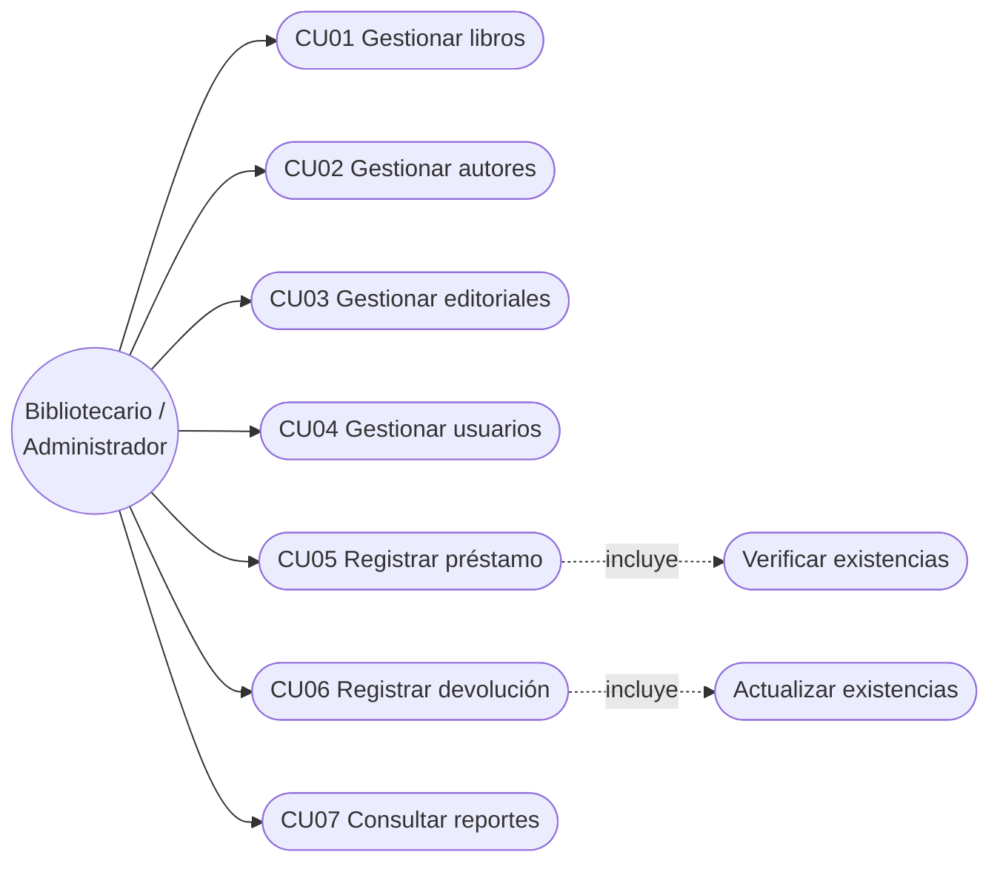
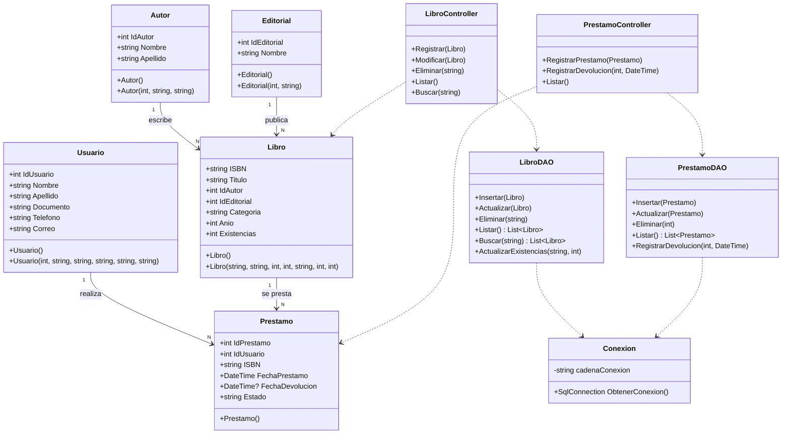
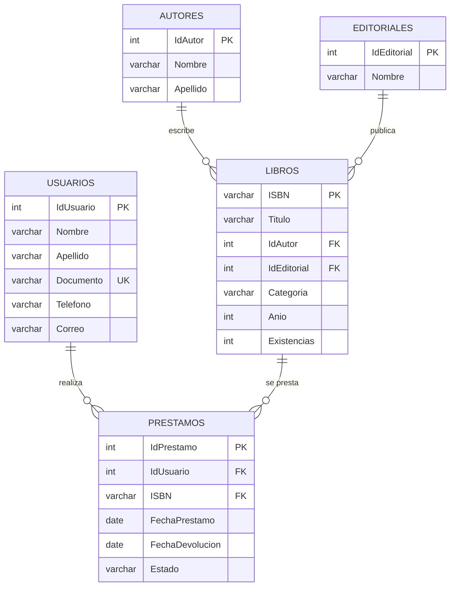
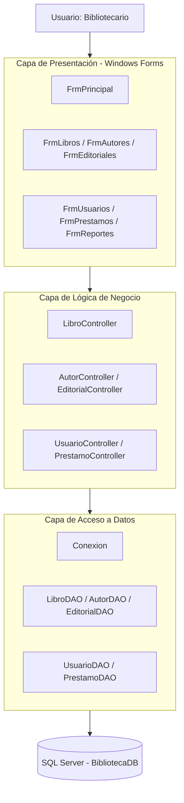

# ACA – Programación Avanzada

# Sistema de Gestión de Biblioteca

---

## PORTADA

**[Coorporacion Unificada de Educacion Superior - CUN]**

**[Ingenieria de Sistemas / Programacion Avanzada]**

### ACA – Programación Avanzada

### Sistema de Gestión de Biblioteca

**Presentado por:**
[Laura Lilian Gonzalez Castiblanco]

**Docente:**
[Veronica Castro Munar]

**Fecha:**
[Bogota], 5 de noviembre de 2026

<div style="page-break-after: always;"></div>

# CONTRAPORTADA

**Sistema de Gestión de Biblioteca**

Proyecto desarrollado como evidencia del curso de **Programación Avanzada**, aplicando Programación Orientada a Objetos, base de datos relacional, arquitectura por capas, operaciones CRUD, validaciones, manejo de excepciones y conexión con SQL Server.

**Estudiante(s):** [Laura Lilian Gonzalez Castiblanco]
**Programa:** [Programacion Avanzada]
**Grupo:** [Ficha 54465]
**Docente:** [Veronica Castro Munar]
**Institución:** [Coorporacion Unificada de Educacion Superior - CUN ]
**Año:** 2026

<div style="page-break-after: always;"></div>

# TABLA DE CONTENIDO

1. [Introducción](#1-introducción)
2. [Objetivos](#2-objetivos)
   - 2.1 Objetivo general
   - 2.2 Objetivos específicos
3. [Planteamiento del problema](#3-planteamiento-del-problema)
4. [Análisis de requerimientos](#4-análisis-de-requerimientos)
5. [Casos de uso](#5-casos-de-uso)
6. [Diagrama de clases](#6-diagrama-de-clases)
7. [Modelo entidad-relación (análisis y normalización)](#7-modelo-entidad-relación)
8. [Diccionario de datos](#8-diccionario-de-datos)
9. [Arquitectura del sistema](#9-arquitectura-del-sistema)
10. [Explicación de los módulos desarrollados](#10-explicación-de-cada-módulo-desarrollado)
11. [Descripción de la conexión con SQL Server](#11-descripción-de-la-conexión-con-sql-server)
12. [Capturas de pantalla del sistema](#12-capturas-de-pantalla-del-sistema)
13. [Pruebas de funcionamiento](#13-pruebas-de-funcionamiento)
14. [Conclusiones](#14-conclusiones)
15. [Recomendaciones](#15-recomendaciones)
16. [Referencias bibliográficas](#16-referencias-bibliográficas)
17. [Anexos](#anexos)


<div style="page-break-after: always;"></div>

# 1. INTRODUCCIÓN

El presente documento describe el desarrollo del **Sistema de Gestión de Biblioteca**, una aplicación de escritorio cuyo propósito es facilitar la administración de los procesos de una biblioteca institucional: el registro y control de **libros, autores, editoriales y usuarios**, así como la gestión de **préstamos y devoluciones** y la consulta de información mediante **reportes**.

El sistema fue desarrollado utilizando **C#, Windows Forms y SQL Server**, aplicando los principios de la Programación Orientada a Objetos (clases, objetos, constructores, encapsulamiento, métodos y propiedades) y una **arquitectura por capas** que separa la presentación, la lógica de negocio, el acceso a datos y el almacenamiento.

La aplicación permite:

- Administrar libros, autores, editoriales y usuarios mediante operaciones CRUD (crear, consultar, actualizar y eliminar).
- Relacionar cada libro con su autor y su editorial.
- Registrar préstamos de libros a usuarios y gestionar su devolución.
- Controlar el estado de cada préstamo (*Prestado* / *Devuelto*) y las existencias de cada libro.
- Consultar información consolidada mediante un módulo de reportes.

Además, el proyecto incluye el diseño y la normalización de la base de datos hasta Tercera Forma Normal (3FN), validaciones de datos, manejo de excepciones, consultas parametrizadas y control de versiones con Git y GitHub.

---

# 2. OBJETIVOS

## 2.1 Objetivo general

Desarrollar una aplicación de escritorio para la gestión integral de una biblioteca, utilizando C#, Windows Forms y SQL Server, que permita administrar libros, autores, editoriales y usuarios, gestionar préstamos y devoluciones y generar reportes, aplicando los principios de la Programación Orientada a Objetos, una base de datos relacional y una arquitectura por capas.

## 2.2 Objetivos específicos

- Aplicar los principios de Programación Orientada a Objetos en el diseño de las clases del sistema.
- Diseñar y normalizar una base de datos relacional (hasta 3FN) y construirla en SQL Server.
- Implementar operaciones CRUD para libros, autores, editoriales, usuarios y préstamos.
- Implementar una arquitectura por capas que separe presentación, lógica de negocio y acceso a datos.
- Validar la información ingresada por el usuario y manejar excepciones de forma controlada.
- Implementar formularios en Windows Forms que faciliten el registro, la consulta, la actualización y la eliminación de datos.
- Implementar consultas y reportes que faciliten la administración de la biblioteca.
- Utilizar Git y GitHub como sistema de control de versiones.
- Documentar técnicamente el proyecto.

---

# 3. PLANTEAMIENTO DEL PROBLEMA

## 3.1 Descripción del problema

Una institución educativa requiere una aplicación de escritorio que facilite la administración de los procesos de su biblioteca. La gestión de libros, autores, editoriales y usuarios, así como el control de préstamos y devoluciones, exige un sistema organizado que permita registrar, consultar, actualizar y eliminar información, además de hacer seguimiento al estado de los préstamos y generar reportes.

Cuando esta información se maneja de forma manual o en archivos dispersos, se presentan problemas como:

- **Redundancia de datos:** el mismo autor, editorial o usuario se repite en múltiples registros.
- **Inconsistencias:** al cambiar un dato (por ejemplo, el nombre de una editorial) este debe corregirse en muchos lugares.
- **Dificultad para conocer la disponibilidad** de los libros y el estado de los préstamos.
- **Pérdida de información** y errores de digitación por falta de validaciones.

Para atender esta necesidad se propone desarrollar un Sistema de Gestión de Biblioteca que centralice la información bibliográfica, administre los usuarios, gestione préstamos y devoluciones, y permita consultar información mediante reportes, garantizando la integridad y consistencia de los datos almacenados.

## 3.2 Justificación

Contar con un sistema de gestión de biblioteca permite:

- **Organizar** la información en una única base de datos relacional, evitando duplicidad.
- **Agilizar** los procesos de registro, búsqueda, préstamo y devolución.
- **Controlar** la disponibilidad de los libros y el estado de cada préstamo.
- **Reducir errores** mediante validaciones y restricciones de integridad.
- **Facilitar la toma de decisiones** mediante reportes (libros, préstamos activos, historial).

Desde el punto de vista académico, el proyecto integra los contenidos del curso: POO, bases de datos, arquitectura por capas, manejo de excepciones y control de versiones.

## 3.3 Alcance

El sistema permitirá:

- Presentar un formulario principal con navegación entre módulos.
- Gestionar libros (CRUD y búsqueda).
- Gestionar autores (CRUD).
- Gestionar editoriales (CRUD).
- Gestionar usuarios (CRUD).
- Registrar, consultar, editar y eliminar préstamos.
- Registrar devoluciones y actualizar el estado del préstamo.
- Consultar el estado de los préstamos (Prestado / Devuelto).
- Consultar reportes de la biblioteca.

### Fuera del alcance

- Autenticación de usuarios y manejo de roles/permisos.
- Cálculo de multas por retraso en la devolución.
- Reservas de libros y notificaciones por correo electrónico.
- Un libro con varios autores (en este modelo, cada libro tiene un único autor).
- Aplicación web o móvil.

---

# 4. ANÁLISIS DE REQUERIMIENTOS

## 4.1 Descripción general

El Sistema de Gestión de Biblioteca permitirá administrar la información relacionada con **libros, autores, editoriales, usuarios y préstamos**, y controlar los procesos de **préstamo, devolución y consulta** de la biblioteca.

## 4.2 Actores del sistema

| Actor | Descripción |
|---|---|
| Bibliotecario / Administrador | Usuario del sistema. Registra y mantiene la información de libros, autores, editoriales y usuarios; registra préstamos y devoluciones; consulta los reportes. |

> Los lectores (usuarios de la biblioteca) son **entidades administradas** por el sistema, pero no interactúan directamente con la aplicación.

## 4.3 Requerimientos funcionales

| Código | Requerimiento | Descripción |
|---|---|---|
| RF01 | Gestión de libros | Registrar, consultar/listar, editar y eliminar libros; buscar por ISBN (código), título o autor; relacionar cada libro con su autor y editorial; consultar existencias. |
| RF02 | Gestión de autores | Registrar, consultar/listar, editar y eliminar autores (IdAutor, Nombre, Apellido), respetando las restricciones de integridad. |
| RF03 | Gestión de editoriales | Registrar, consultar/listar, editar y eliminar editoriales (IdEditorial, Nombre), respetando las restricciones de integridad. |
| RF04 | Gestión de usuarios | Registrar, consultar/listar, editar y eliminar usuarios (IdUsuario, Nombre, Apellido, Documento, Teléfono, Correo). |
| RF05 | Gestión de préstamos | Registrar préstamos asociando un usuario y un libro; registrar fecha de préstamo; consultar, editar y eliminar préstamos; consultar el estado (Prestado/Devuelto). |
| RF06 | Gestión de devoluciones | Registrar la devolución de un préstamo: actualizar fecha de devolución, cambiar el estado a «Devuelto» y actualizar las existencias del libro. |
| RF07 | Consultas y reportes | Listado de libros, autores y editoriales, usuarios, préstamos registrados, préstamos activos y devueltos, historial de préstamos. |
| RF08 | Navegación del sistema | Formulario principal con acceso a Inicio, Libros, Usuarios, Autores, Editoriales, Préstamos y Reportes. |

## 4.4 Requerimientos no funcionales

| Código | Requerimiento | Descripción |
|---|---|---|
| RNF01 | Usabilidad | Interfaz gráfica clara, organizada y fácil de utilizar. |
| RNF02 | Validación | Validación de campos obligatorios, tipos y longitudes antes de guardar. |
| RNF03 | Mantenibilidad | Código organizado, legible y con nombres descriptivos para clases, métodos, variables y controles. |
| RNF04 | Arquitectura | Separación de responsabilidades entre presentación, lógica de negocio y acceso a datos. |
| RNF05 | Manejo de excepciones | Las operaciones deben manejar errores de forma controlada y mostrar mensajes claros. |
| RNF06 | Integridad de datos | Uso de claves primarias, foráneas y restricciones (UNIQUE, NOT NULL, CHECK) en SQL Server. |
| RNF07 | Consultas parametrizadas | Todas las consultas a la base de datos deben usar parámetros (previene inyección SQL). |
| RNF08 | Prevención de duplicados | Evitar registros duplicados donde existan restricciones de unicidad (ISBN, Documento). |

## 4.5 Reglas de negocio

- **RN01 – ISBN único:** no se permite registrar dos libros con el mismo ISBN (clave primaria).
- **RN02 – Datos obligatorios:** no se permite almacenar registros con campos obligatorios vacíos o nulos.
- **RN03 – Documento único:** el documento del usuario debe ser único.
- **RN04 – Un autor por libro:** un libro tiene un solo autor en este modelo.
- **RN05 – Editorial con muchos libros:** una editorial puede publicar muchos libros.
- **RN06 – Usuario existente:** no se puede registrar un préstamo para un usuario inexistente.
- **RN07 – Libro existente:** no se puede registrar un préstamo para un libro inexistente.
- **RN08 – Disponibilidad:** no se puede prestar un libro si no hay existencias (`Existencias = 0`).
- **RN09 – Préstamo múltiple:** un usuario puede tener varios préstamos y un libro puede prestarse muchas veces (según existencias).
- **RN10 – Actualización de existencias:** al registrar un préstamo, las existencias del libro disminuyen en 1; al registrar la devolución, aumentan en 1.
- **RN11 – Estado coherente:** un préstamo con estado «Devuelto» debe tener `FechaDevolucion`; un préstamo «Prestado» no tiene fecha de devolución.
- **RN12 – Integridad referencial:** no se pueden eliminar autores, editoriales, usuarios o libros que estén referenciados por otros registros.

---

# 5. CASOS DE USO

## 5.1 Descripción

Los casos de uso describen cómo el **Bibliotecario/Administrador** interactúa con las funcionalidades principales del sistema.

## 5.2 Diagrama de casos de uso



> *Si la profesora exige el diagrama en notación UML clásica, puede redibujarse en draw.io / StarUML con estos mismos casos y guardarse como imagen `diagramas/casos-uso.png`.*

## 5.3 Descripción de casos de uso

### CU01 – Gestionar libros

**Actor principal:** Bibliotecario / Administrador

**Descripción:** permite registrar, consultar, actualizar, eliminar y buscar libros.

**Precondiciones:**
- La aplicación está conectada a la base de datos.
- Existen autores y editoriales registrados (para asociarlos al libro).

**Flujo principal:**
1. El actor ingresa al módulo de libros.
2. El sistema muestra los libros registrados en un `DataGridView`.
3. El actor selecciona la operación (registrar, editar, eliminar o buscar).
4. El actor completa o modifica los datos (ISBN, título, autor, editorial, categoría, año, existencias).
5. El sistema valida los datos y ejecuta la operación.
6. El sistema muestra un mensaje de confirmación y actualiza el listado.

**Flujos alternativos:**
- Campos obligatorios vacíos → el sistema muestra un mensaje y no guarda.
- ISBN duplicado → el sistema informa que el libro ya existe.
- Libro con préstamos asociados → el sistema impide la eliminación.

**Postcondiciones:** el libro queda registrado, actualizado o eliminado en la base de datos.

---

### CU02 – Gestionar autores

**Actor principal:** Bibliotecario / Administrador
**Descripción:** permite registrar, consultar, actualizar y eliminar autores.
**Precondiciones:** conexión activa con la base de datos.
**Flujo principal:** ingresar al módulo → ver listado → diligenciar Nombre y Apellido → guardar/editar/eliminar → el sistema valida y confirma.
**Flujos alternativos:** campos vacíos; autor con libros asociados (no se puede eliminar).
**Postcondiciones:** el autor queda registrado o actualizado.

### CU03 – Gestionar editoriales

**Actor principal:** Bibliotecario / Administrador
**Descripción:** permite registrar, consultar, actualizar y eliminar editoriales.
**Precondiciones:** conexión activa con la base de datos.
**Flujo principal:** ingresar al módulo → ver listado → diligenciar Nombre → guardar/editar/eliminar → el sistema valida y confirma.
**Flujos alternativos:** nombre vacío; editorial con libros asociados (no se puede eliminar).
**Postcondiciones:** la editorial queda registrada o actualizada.

### CU04 – Gestionar usuarios

**Actor principal:** Bibliotecario / Administrador
**Descripción:** permite registrar, consultar, actualizar y eliminar usuarios de la biblioteca.
**Precondiciones:** conexión activa con la base de datos.
**Flujo principal:** ingresar al módulo → ver listado → diligenciar Nombre, Apellido, Documento, Teléfono y Correo → guardar/editar/eliminar → el sistema valida y confirma.
**Flujos alternativos:** documento duplicado; correo con formato inválido; usuario con préstamos asociados (no se puede eliminar).
**Postcondiciones:** el usuario queda registrado o actualizado.

---

### CU05 – Registrar préstamo

**Actor principal:** Bibliotecario / Administrador

**Descripción:** permite registrar el préstamo de un libro a un usuario.

**Precondiciones:**
- El usuario debe existir.
- El libro debe existir.
- El libro debe tener existencias (`Existencias > 0`).

**Flujo principal:**
1. El actor ingresa al módulo de préstamos.
2. Selecciona el usuario (`ComboBox`).
3. Selecciona el libro (`ComboBox`).
4. Indica la fecha del préstamo (`DateTimePicker`).
5. El sistema verifica las existencias.
6. El sistema registra el préstamo con estado «Prestado».
7. El sistema descuenta una existencia del libro.
8. El sistema muestra la confirmación y actualiza el listado.

**Flujos alternativos:**
- Usuario o libro inexistente.
- Libro sin existencias → no se permite el préstamo.
- Error de base de datos → se revierte la operación y se muestra el mensaje.

**Postcondiciones:** el préstamo queda registrado y las existencias del libro actualizadas.

---

### CU06 – Registrar devolución

**Actor principal:** Bibliotecario / Administrador

**Descripción:** permite registrar la devolución de un libro asociado a un préstamo.

**Precondiciones:** debe existir un préstamo con estado «Prestado».

**Flujo principal:**
1. El actor selecciona el préstamo activo.
2. Indica la fecha de devolución.
3. El sistema valida que la fecha no sea anterior a la fecha del préstamo.
4. El sistema actualiza `FechaDevolucion` y cambia el estado a «Devuelto».
5. El sistema incrementa en 1 las existencias del libro.
6. El sistema muestra la confirmación.

**Flujos alternativos:**
- Préstamo ya devuelto → el sistema lo informa y no repite la operación.
- Fecha de devolución inválida.

**Postcondiciones:** el préstamo queda en estado «Devuelto» y las existencias actualizadas.

---

### CU07 – Consultar reportes

**Actor principal:** Bibliotecario / Administrador
**Descripción:** permite consultar información consolidada de la biblioteca.
**Flujo principal:** ingresar al módulo de reportes → elegir el reporte → el sistema ejecuta la consulta y muestra los resultados.
**Postcondiciones:** la información se muestra en pantalla.

---

# 6. DIAGRAMA DE CLASES

## 6.1 Descripción

El sistema se modela con **clases de entidad** (que representan las tablas de la base de datos), **clases de lógica de negocio** (servicios/controladores) y **clases de acceso a datos** (DAO/repositorios). Cada clase de entidad usa **propiedades** con encapsulamiento y **constructores** para inicializar sus objetos.

## 6.2 Diagrama de clases



> *Se muestran como ejemplo los DAO/Controllers de Libro y Préstamo; el patrón se repite para Autor, Editorial y Usuario. **Ajuste los nombres a los de su proyecto real.***

## 6.3 Principales clases

| Clase | Responsabilidad |
|---|---|
| `Autor` | Representar los datos de un autor (IdAutor, Nombre, Apellido). |
| `Editorial` | Representar los datos de una editorial (IdEditorial, Nombre). |
| `Libro` | Representar la información bibliográfica y las existencias de un libro. |
| `Usuario` | Representar a los usuarios de la biblioteca. |
| `Prestamo` | Representar un préstamo: usuario, libro, fechas y estado. |
| `Conexion` | Crear y entregar la conexión a SQL Server. |
| `*DAO` | Ejecutar las operaciones CRUD y consultas parametrizadas sobre cada tabla. |
| `*Controller` | Aplicar reglas de negocio y validaciones, y coordinar a la capa de datos. |
| Formularios (`Frm*`) | Capturar datos, mostrar resultados y mensajes al usuario. |

## 6.4 Aplicación de POO

- **Clases y objetos:** cada entidad del modelo (Libro, Autor, Editorial, Usuario, Préstamo) se representa con una clase; cada registro cargado se instancia como un objeto.
- **Constructores:** cada clase de entidad tiene un constructor vacío y uno con parámetros para inicializar sus atributos.
- **Propiedades y encapsulamiento:** los atributos se exponen mediante propiedades (`get; set;`); los detalles internos (como la cadena de conexión) se declaran `private`.
- **Métodos:** los DAO y controladores agrupan los métodos de insertar, actualizar, eliminar, listar y buscar.
- **Colecciones:** los listados se manejan con `List<T>` (por ejemplo, `List<Libro>`), que se enlazan a los `DataGridView` y `ComboBox`.
- **Organización de responsabilidades:** cada clase tiene una única responsabilidad (entidad, acceso a datos, lógica o interfaz).
- **Herencia / polimorfismo (opcional):** [Si se implementó, por ejemplo una clase base `EntidadBase` o `BaseDAO<T>`, describirlo aquí. Si no, eliminar este punto.]

---

# 7. MODELO ENTIDAD-RELACIÓN

## 7.1 Descripción y análisis

El modelo se diseñó a partir del análisis de los requisitos del sistema, que debe permitir registrar, consultar, modificar y eliminar libros; administrar autores, editoriales y usuarios; relacionar cada libro con su autor y editorial; gestionar préstamos y devoluciones; controlar el estado del libro; validar datos obligatorios y evitar duplicados; y generar reportes.

### 7.1.1 Determinación de entidades y atributos

| Entidad | Atributos principales |
|---|---|
| Autor | IdAutor, Nombre, Apellido |
| Editorial | IdEditorial, Nombre |
| Libro | ISBN, Título, IdAutor, IdEditorial, Categoría, Año, Existencias |
| Usuario | IdUsuario, Nombre, Apellido, Documento, Teléfono, Correo |
| Préstamo | IdPréstamo, IdUsuario, ISBN, FechaPréstamo, FechaDevolución, Estado |

### 7.1.2 Tabla inicial (sin normalizar)

En una primera aproximación, toda la información podría almacenarse en una única tabla:

**BIBLIOTECA (No normalizada)**

| IdPréstamo | FechaPréstamo | FechaDevolución | Estado | ISBN | Título | NombreAutor | NombreEditorial | NombreUsuario | DocumentoUsuario |
|---|---|---|---|---|---|---|---|---|---|
| 1 | 01/03/2026 | 15/03/2026 | Prestado | 978123 | C# Básico | Juan Pérez | McGraw-Hill | Ana López | 12345678 |

**Problemas de esta tabla:**
- **Redundancia de datos:** autores, editoriales y usuarios se repiten.
- **Anomalías de inserción:** no se puede registrar un autor sin un libro.
- **Anomalías de actualización:** cambiar un dato implica modificar muchas filas.
- **Anomalías de eliminación:** al borrar un libro se pierde información relacionada.

### 7.1.3 Proceso de normalización

| Forma normal | Criterio aplicado | Resultado |
|---|---|---|
| **1FN** | Cada campo contiene un único valor (no hay listas de autores, editoriales o usuarios) y se eliminan los grupos repetidos. | Datos atómicos. |
| **2FN** | Los atributos no clave dependen de la clave primaria completa de su tabla; se separan los datos que corresponden a entidades diferentes. | Se separan Autores, Editoriales, Usuarios, Libros y Préstamos. |
| **3FN** | Se eliminan las dependencias transitivas; cada atributo depende solo de la clave primaria de su tabla. | Los datos de autor/editorial/usuario dependen de su propia tabla y no del libro/préstamo. |

**Resultado:** se obtienen **5 tablas relacionadas** que eliminan redundancias y garantizan la integridad referencial: **Autores, Editoriales, Libros, Usuarios y Préstamos**.

## 7.2 Diagrama entidad-relación



> *Pegue aquí también la imagen del MER entregada por la docente o exportada desde su herramienta (draw.io, MySQL Workbench, SSMS):*
> ``

## 7.3 Relaciones y cardinalidad

| Relación | Cardinalidad | Descripción |
|---|---|---|
| Autores → Libros | 1 : N | Un autor puede escribir muchos libros; cada libro tiene un solo autor. |
| Editoriales → Libros | 1 : N | Una editorial puede publicar muchos libros; cada libro tiene una sola editorial. |
| Usuarios → Préstamos | 1 : N | Un usuario puede realizar varios préstamos. |
| Libros → Préstamos | 1 : N | Un libro puede ser prestado muchas veces (según existencias). |

---

# 8. DICCIONARIO DE DATOS

## 8.1 Convenciones

| Abreviatura | Significado |
|---|---|
| PK | Clave primaria |
| FK | Clave foránea |
| UQ | Campo con valor único |
| NULL | Campo que puede estar vacío |
| NOT NULL | Campo obligatorio |

> **Base de datos:** `BibliotecaDB` (SQL Server). La columna «Año» se nombra `Anio` en el script SQL para evitar problemas con caracteres especiales.

## 8.2 Tabla: Autores

| Campo | Tipo de dato | Clave | Nulo | Descripción |
|---|---|---|---|---|
| IdAutor | INT IDENTITY(1,1) | PK | No | Identificador único del autor. |
| Nombre | VARCHAR(100) | - | No | Nombre del autor. |
| Apellido | VARCHAR(100) | - | No | Apellido del autor. |

## 8.3 Tabla: Editoriales

| Campo | Tipo de dato | Clave | Nulo | Descripción |
|---|---|---|---|---|
| IdEditorial | INT IDENTITY(1,1) | PK | No | Identificador único de la editorial. |
| Nombre | VARCHAR(150) | - | No | Nombre de la editorial. |

## 8.4 Tabla: Libros

| Campo | Tipo de dato | Clave | Nulo | Descripción |
|---|---|---|---|---|
| ISBN | VARCHAR(20) | PK | No | Código ISBN único del libro. |
| Titulo | VARCHAR(200) | - | No | Título del libro. |
| IdAutor | INT | FK → Autores(IdAutor) | No | Autor del libro. |
| IdEditorial | INT | FK → Editoriales(IdEditorial) | No | Editorial del libro. |
| Categoria | VARCHAR(100) | - | No | Categoría o género del libro. |
| Anio | INT | - | No | Año de publicación. |
| Existencias | INT | - | No | Cantidad de ejemplares disponibles (CHECK ≥ 0). |

## 8.5 Tabla: Usuarios

| Campo | Tipo de dato | Clave | Nulo | Descripción |
|---|---|---|---|---|
| IdUsuario | INT IDENTITY(1,1) | PK | No | Identificador único del usuario. |
| Nombre | VARCHAR(100) | - | No | Nombre del usuario. |
| Apellido | VARCHAR(100) | - | No | Apellido del usuario. |
| Documento | VARCHAR(30) | UQ | No | Número de documento (único). |
| Telefono | VARCHAR(30) | - | Sí | Teléfono de contacto. |
| Correo | VARCHAR(150) | - | No | Correo electrónico. |

## 8.6 Tabla: Prestamos

| Campo | Tipo de dato | Clave | Nulo | Descripción |
|---|---|---|---|---|
| IdPrestamo | INT IDENTITY(1,1) | PK | No | Identificador único del préstamo. |
| IdUsuario | INT | FK → Usuarios(IdUsuario) | No | Usuario que realiza el préstamo. |
| ISBN | VARCHAR(20) | FK → Libros(ISBN) | No | Libro prestado. |
| FechaPrestamo | DATE | - | No | Fecha en que se realizó el préstamo. |
| FechaDevolucion | DATE | - | Sí | Fecha de devolución (NULL mientras no se devuelva). |
| Estado | VARCHAR(20) | - | No | Estado del préstamo (`Prestado` / `Devuelto`; el modelo también contempla `Disponible`). |

## 8.7 Reglas de negocio y restricciones en la base de datos

- Un libro puede tener **un solo autor** (FK `IdAutor`).
- Una editorial puede publicar **muchos libros**.
- Un usuario puede tener **varios préstamos**.
- Un libro puede prestarse muchas veces según **existencias**.
- No se puede prestar un libro si **no hay existencias**.
- El **documento** del usuario debe ser **único** (`UNIQUE`).
- Los campos obligatorios **no pueden ser nulos** (`NOT NULL`).

---

# 9. ARQUITECTURA DEL SISTEMA

## 9.1 Descripción general

El sistema se desarrolla con una **arquitectura por capas**, con el propósito de separar las responsabilidades y facilitar el mantenimiento, la organización y la evolución del código.

1. Capa de Presentación (Windows Forms).
2. Capa de Lógica de Negocio.
3. Capa de Acceso a Datos.
4. Capa de Base de Datos (SQL Server).

> **Nota:** la arquitectura debe documentarse según la organización **real** del código fuente. Si los componentes no están separados físicamente en proyectos/carpetas distintas, se presenta como una arquitectura lógica propuesta.

## 9.2 Diagrama de arquitectura



## 9.3 Capa de Presentación

**Responsabilidad:** permite al usuario interactuar con el sistema: captura datos, realiza validación inicial y presenta resultados y mensajes.

**Componentes (formularios):** `FrmPrincipal`, `FrmLibros`, `FrmAutores`, `FrmEditoriales`, `FrmUsuarios`, `FrmPrestamos`, `FrmReportes`.

**Tecnología:** C#, Windows Forms, .NET [versión utilizada, p. ej. .NET Framework 4.8 / .NET 8].

**Controles utilizados:** `Label`, `TextBox`, `ComboBox`, `DataGridView`, `Button`, `GroupBox`, `Panel`, `DateTimePicker`.

## 9.4 Capa de Lógica de Negocio

**Responsabilidad:** procesa las solicitudes de la interfaz, aplica las reglas del sistema, valida operaciones y coordina los procesos de libros, autores, editoriales, usuarios y préstamos.

**Componentes:** `LibroController`, `AutorController`, `EditorialController`, `UsuarioController`, `PrestamoController`.

**Ejemplos de reglas aplicadas:**
- Validar que los campos obligatorios no estén vacíos.
- Validar la existencia del usuario y del libro.
- Validar que existan existencias antes de prestar.
- Actualizar las existencias y el estado en préstamos y devoluciones.
- Validar la coherencia de las fechas.

## 9.5 Capa de Acceso a Datos

**Responsabilidad:** gestiona la comunicación entre la aplicación y SQL Server: conexión, consultas parametrizadas y operaciones de inserción, consulta, actualización y eliminación.

**Componentes:** `Conexion`, `LibroDAO`, `AutorDAO`, `EditorialDAO`, `UsuarioDAO`, `PrestamoDAO`.

**Tecnologías:** SQL Server, ADO.NET (`SqlConnection`, `SqlCommand`, `SqlDataAdapter`/`SqlDataReader`), consultas parametrizadas.

## 9.6 Capa de Base de Datos

**Base de datos:** `BibliotecaDB`
**Tablas:** `Autores`, `Editoriales`, `Libros`, `Usuarios`, `Prestamos`.
Incluye claves primarias y foráneas, restricciones `UNIQUE`, `NOT NULL` y `CHECK`.

## 9.7 Flujo de información

```text
Usuario
   ↓
Presentación (Formularios)
   ↓
Lógica de Negocio (Controllers)
   ↓
Acceso a Datos (DAO / Conexión)
   ↓
SQL Server
```

Las respuestas de la base de datos realizan el recorrido inverso hasta llegar a la interfaz.

---

# 10. EXPLICACIÓN DE CADA MÓDULO DESARROLLADO

## 10.1 Módulo de inicio (formulario principal)

**Objetivo:** presentar la interfaz principal y facilitar la navegación entre módulos.
**Funcionalidades:** menú/botones de acceso a Libros, Usuarios, Autores, Editoriales, Préstamos y Reportes.

## 10.2 Módulo de libros

**Objetivo:** administrar la información bibliográfica y sus relaciones con autores y editoriales.
**Funcionalidades:** registrar, consultar/listar, editar, eliminar y buscar (por ISBN, título o autor); consultar existencias.
**Validaciones:**
- ISBN, título, autor, editorial, categoría, año y existencias obligatorios.
- ISBN único.
- Año y existencias numéricos; existencias no negativas.
- Autor y editorial seleccionados desde `ComboBox` (garantizan que existan).
- No eliminar libros con préstamos asociados.

## 10.3 Módulo de autores

**Objetivo:** administrar los autores de la biblioteca.
**Funcionalidades:** registrar, consultar, editar y eliminar.
**Validaciones:** nombre y apellido obligatorios y dentro de la longitud permitida (100); no eliminar autores con libros asociados.

## 10.4 Módulo de editoriales

**Objetivo:** administrar las editoriales.
**Funcionalidades:** registrar, consultar, editar y eliminar.
**Validaciones:** nombre obligatorio (máx. 150); no eliminar editoriales con libros asociados.

## 10.5 Módulo de usuarios

**Objetivo:** administrar los usuarios de la biblioteca.
**Funcionalidades:** registrar, consultar, editar y eliminar.
**Validaciones:** nombre, apellido, documento y correo obligatorios; documento único; formato de correo válido; longitudes según la base de datos; no eliminar usuarios con préstamos.

## 10.6 Módulo de préstamos

**Objetivo:** registrar y controlar los préstamos de libros a usuarios.
**Funcionalidades:** registrar préstamo (usuario + libro + fecha); consultar préstamos; editar y eliminar según las reglas; consultar estado (Prestado/Devuelto).
**Validaciones:** usuario y libro existentes; libro con existencias; fechas válidas; estado coherente con la fecha de devolución.

## 10.7 Módulo de devoluciones

**Objetivo:** registrar la devolución de un libro prestado.
**Funcionalidades:** seleccionar préstamo activo, registrar fecha de devolución, cambiar estado a «Devuelto» y sumar una existencia al libro.
**Validaciones:** el préstamo debe estar activo; la fecha de devolución no puede ser anterior a la del préstamo.
**Implementación:** la actualización del préstamo y de las existencias se ejecuta dentro de una **transacción** para mantener la consistencia.

## 10.8 Módulo de reportes

**Objetivo:** consultar información consolidada de la biblioteca.
**Reportes (ajustar a los implementados):**
- Listado de libros con autor y editorial.
- Listado de autores y editoriales.
- Listado de usuarios.
- Préstamos registrados.
- Préstamos activos y devueltos.
- Historial de préstamos por usuario.

**Ejemplo de consulta (préstamos activos):**

```sql
SELECT p.IdPrestamo,
       u.Nombre + ' ' + u.Apellido AS Usuario,
       l.Titulo, p.FechaPrestamo, p.Estado
FROM Prestamos p
INNER JOIN Usuarios u ON u.IdUsuario = p.IdUsuario
INNER JOIN Libros   l ON l.ISBN      = p.ISBN
WHERE p.Estado = 'Prestado';
```

> **Importante:** documente solo los módulos y reportes que realmente implementó.

---

# 11. DESCRIPCIÓN DE LA CONEXIÓN CON SQL SERVER

La conexión se gestiona desde la capa de acceso a datos mediante **ADO.NET**, centralizada en la clase `Conexion` para evitar repetir la cadena de conexión.

**Cadena de conexión (ejemplo; ajustar servidor):**

```text
Server=localhost\SQLEXPRESS;Database=BibliotecaDB;Trusted_Connection=True;TrustServerCertificate=True;
```

**Clase de conexión (ejemplo):**

```csharp
using System.Data.SqlClient; // o Microsoft.Data.SqlClient en .NET moderno

public class Conexion
{
    private readonly string cadenaConexion =
        @"Server=localhost\SQLEXPRESS;Database=BibliotecaDB;Trusted_Connection=True;TrustServerCertificate=True;";

    public SqlConnection ObtenerConexion()
    {
        return new SqlConnection(cadenaConexion);
    }
}
```

**Ejemplo de consulta parametrizada con manejo de excepciones:**

```csharp
public bool Insertar(Autor autor)
{
    const string sql = "INSERT INTO Autores (Nombre, Apellido) VALUES (@nombre, @apellido)";
    try
    {
        using (var cn = new Conexion().ObtenerConexion())
        using (var cmd = new SqlCommand(sql, cn))
        {
            cmd.Parameters.AddWithValue("@nombre", autor.Nombre);
            cmd.Parameters.AddWithValue("@apellido", autor.Apellido);
            cn.Open();
            return cmd.ExecuteNonQuery() > 0;
        }
    }
    catch (SqlException ex)
    {
        throw new Exception("Error al registrar el autor: " + ex.Message);
    }
}
```

**Ejemplo de devolución con transacción:**

```csharp
public void RegistrarDevolucion(int idPrestamo, DateTime fecha)
{
    using (var cn = new Conexion().ObtenerConexion())
    {
        cn.Open();
        using (var tx = cn.BeginTransaction())
        {
            try
            {
                var upd = new SqlCommand(
                    @"UPDATE Prestamos SET FechaDevolucion=@f, Estado='Devuelto'
                      WHERE IdPrestamo=@id AND Estado='Prestado'", cn, tx);
                upd.Parameters.AddWithValue("@f", fecha);
                upd.Parameters.AddWithValue("@id", idPrestamo);
                if (upd.ExecuteNonQuery() == 0)
                    throw new InvalidOperationException("El préstamo no está activo.");

                var stock = new SqlCommand(
                    @"UPDATE Libros SET Existencias = Existencias + 1
                      WHERE ISBN = (SELECT ISBN FROM Prestamos WHERE IdPrestamo=@id)", cn, tx);
                stock.Parameters.AddWithValue("@id", idPrestamo);
                stock.ExecuteNonQuery();

                tx.Commit();
            }
            catch { tx.Rollback(); throw; }
        }
    }
}
```

> *Los fragmentos son ilustrativos: reemplácelos por el código real de su proyecto.*

---

# 12. CAPTURAS DE PANTALLA DEL SISTEMA

> Inserte una captura por pantalla y explique brevemente lo que muestra. Guarde las imágenes en la carpeta `capturas/`.

## 12.1 Menú principal

**Descripción:** formulario principal con acceso a los módulos del sistema.

## 12.2 Gestión de libros

**Descripción:** registro, edición, eliminación y búsqueda de libros, con listado en `DataGridView`.

## 12.3 Gestión de autores

**Descripción:** CRUD de autores.

## 12.4 Gestión de editoriales

**Descripción:** CRUD de editoriales.

## 12.5 Gestión de usuarios

**Descripción:** CRUD de usuarios con validación de documento único.

## 12.6 Registro de préstamos

**Descripción:** selección de usuario y libro, fecha de préstamo y estado.

## 12.7 Registro de devoluciones

**Descripción:** devolución de un préstamo activo y cambio de estado a «Devuelto».

## 12.8 Reportes

**Descripción:** consultas consolidadas de la biblioteca.

---

# 13. PRUEBAS DE FUNCIONAMIENTO

## 13.1 Estrategia de pruebas

Se realizaron **pruebas funcionales manuales** sobre cada módulo, ejecutando la aplicación con los datos de prueba del script SQL. Para cada caso se verificó el resultado en pantalla y, cuando fue necesario, directamente en SQL Server (consultando las tablas). Se probaron casos válidos y casos de error (campos vacíos, duplicados, sin existencias, restricciones de integridad).

## 13.2 Casos de prueba

> **Complete las columnas «Resultado obtenido» y «Estado» después de ejecutar cada prueba en su aplicación.** Solo marque *Aprobado* lo que realmente funcionó.

| ID | Funcionalidad | Entrada / Acción | Resultado esperado | Resultado obtenido | Estado |
|---|---|---|---|---|---|
| CP01 | Registrar libro | Datos válidos | Libro registrado y visible en el listado | [Completar] | [ ] |
| CP02 | Registrar libro | ISBN repetido | Mensaje de validación; no se guarda | [Completar] | [ ] |
| CP03 | Registrar libro | Campo obligatorio vacío | Mensaje de campo obligatorio | [Completar] | [ ] |
| CP04 | Registrar autor / editorial | Datos válidos | Registro creado | [Completar] | [ ] |
| CP05 | Eliminar autor | Autor con libros asociados | Se impide la eliminación (integridad) | [Completar] | [ ] |
| CP06 | Registrar usuario | Datos válidos | Usuario registrado | [Completar] | [ ] |
| CP07 | Registrar usuario | Documento duplicado | Mensaje de documento ya registrado | [Completar] | [ ] |
| CP08 | Registrar usuario | Correo con formato inválido | Mensaje de validación | [Completar] | [ ] |
| CP09 | Registrar préstamo | Usuario y libro con existencias | Préstamo «Prestado»; existencias −1 | [Completar] | [ ] |
| CP10 | Registrar préstamo | Libro con `Existencias = 0` | No se permite el préstamo | [Completar] | [ ] |
| CP11 | Registrar devolución | Préstamo activo | Estado «Devuelto», fecha registrada, existencias +1 | [Completar] | [ ] |
| CP12 | Registrar devolución | Préstamo ya devuelto | Mensaje informativo; no se repite | [Completar] | [ ] |
| CP13 | Editar libro | Cambiar categoría/año | Datos actualizados | [Completar] | [ ] |
| CP14 | Buscar libro | Texto parcial del título | Se listan las coincidencias | [Completar] | [ ] |
| CP15 | Reporte préstamos activos | Abrir reporte | Se muestran solo préstamos «Prestado» | [Completar] | [ ] |

## 13.3 Evidencias de pruebas

### Prueba CP02 – ISBN duplicado

**Resultado:** [Descripción]

### Prueba CP09 – Registro de préstamo

**Resultado:** [Descripción]

### Prueba CP11 – Devolución

**Resultado:** [Descripción]

---

# 14. CONCLUSIONES

1. **Logro del proyecto:** se desarrolló una aplicación de escritorio en C# con Windows Forms y SQL Server que permite administrar libros, autores, editoriales y usuarios, y gestionar préstamos, devoluciones y reportes, cumpliendo con el alcance definido.

2. **POO:** la aplicación de clases, objetos, constructores, propiedades y encapsulamiento permitió representar las entidades del negocio de forma ordenada y reutilizable, y separar las responsabilidades entre clases de entidad, lógica y acceso a datos.

3. **Base de datos y arquitectura:** la normalización hasta 3FN eliminó la redundancia y las anomalías de inserción, actualización y eliminación, dando origen a cinco tablas relacionadas con integridad referencial. La arquitectura por capas facilitó el mantenimiento y la comprensión del sistema.

4. **Validaciones y excepciones:** el uso de validaciones, consultas parametrizadas y manejo de excepciones aumentó la confiabilidad de la aplicación y previno errores de captura e inconsistencias en los datos.

5. **Dificultades y soluciones:** [Describa las dificultades reales que tuvo, por ejemplo la conexión a SQL Server, el manejo de claves foráneas al eliminar o la actualización de existencias, y cómo las resolvió.]

---

# 15. RECOMENDACIONES

- **Futuras mejoras:** incorporar autenticación con roles (administrador/bibliotecario), cálculo de multas por retraso, reservas de libros y soporte para varios autores por libro (tabla intermedia `LibroAutor`).
- **Seguridad:** no almacenar credenciales en el código; usar autenticación de Windows o variables de configuración, y mantener consultas parametrizadas.
- **Mantenimiento:** realizar copias de seguridad periódicas de la base de datos y mantener el repositorio con commits frecuentes y descriptivos.
- **Nuevas funcionalidades:** exportar reportes a PDF/Excel, agregar gráficos y alertas de préstamos vencidos.
- **Calidad:** agregar pruebas unitarias a la capa de lógica de negocio.

---

# 16. REFERENCIAS BIBLIOGRÁFICAS

> Normas APA 7.ª edición. **Deje únicamente las fuentes que realmente consultó.**

Date, C. J. (2019). *An introduction to database systems* (8.ª ed.). Pearson.

Microsoft. (s. f.). *Windows Forms documentation*. Microsoft Learn. https://learn.microsoft.com/en-us/dotnet/desktop/winforms/

Microsoft. (s. f.). *SQL Server documentation*. Microsoft Learn. https://learn.microsoft.com/en-us/sql/sql-server/

Microsoft. (s. f.). *ADO.NET overview*. Microsoft Learn. https://learn.microsoft.com/en-us/dotnet/framework/data/adonet/ado-net-overview

Microsoft. (s. f.). *C# documentation*. Microsoft Learn. https://learn.microsoft.com/en-us/dotnet/csharp/

Silberschatz, A., Korth, H. F., & Sudarshan, S. (2019). *Fundamentos de bases de datos* (7.ª ed.). McGraw-Hill.

---

# ANEXOS

## Anexo A. Repositorio GitHub

**Repositorio:** [Enlace al repositorio]

Estructura sugerida:

```text
/Biblioteca
 ├── src/                 (proyecto de Visual Studio)
 ├── database/
 │    └── BibliotecaDB.sql
 ├── docs/
 │    └── Documento_Sistema_Gestion_Biblioteca.md
 ├── capturas/
 └── README.md
```

## Anexo B. Script de base de datos

**Archivo:** `BibliotecaDB.sql`

```sql
-- =====================================================
-- Sistema de Gestión de Biblioteca - SQL Server
-- =====================================================
CREATE DATABASE BibliotecaDB;
GO
USE BibliotecaDB;
GO

-- ---------- TABLAS ----------
CREATE TABLE Autores (
    IdAutor     INT IDENTITY(1,1) PRIMARY KEY,
    Nombre      VARCHAR(100) NOT NULL,
    Apellido    VARCHAR(100) NOT NULL
);

CREATE TABLE Editoriales (
    IdEditorial INT IDENTITY(1,1) PRIMARY KEY,
    Nombre      VARCHAR(150) NOT NULL
);

CREATE TABLE Libros (
    ISBN        VARCHAR(20)  PRIMARY KEY,
    Titulo      VARCHAR(200) NOT NULL,
    IdAutor     INT          NOT NULL,
    IdEditorial INT          NOT NULL,
    Categoria   VARCHAR(100) NOT NULL,
    Anio        INT          NOT NULL,
    Existencias INT          NOT NULL,
    CONSTRAINT FK_Libros_Autores     FOREIGN KEY (IdAutor)     REFERENCES Autores(IdAutor),
    CONSTRAINT FK_Libros_Editoriales FOREIGN KEY (IdEditorial) REFERENCES Editoriales(IdEditorial),
    CONSTRAINT CK_Libros_Existencias CHECK (Existencias >= 0),
    CONSTRAINT CK_Libros_Anio        CHECK (Anio > 0)
);

CREATE TABLE Usuarios (
    IdUsuario   INT IDENTITY(1,1) PRIMARY KEY,
    Nombre      VARCHAR(100) NOT NULL,
    Apellido    VARCHAR(100) NOT NULL,
    Documento   VARCHAR(30)  NOT NULL,
    Telefono    VARCHAR(30)  NULL,
    Correo      VARCHAR(150) NOT NULL,
    CONSTRAINT UQ_Usuarios_Documento UNIQUE (Documento)
);

CREATE TABLE Prestamos (
    IdPrestamo      INT IDENTITY(1,1) PRIMARY KEY,
    IdUsuario       INT         NOT NULL,
    ISBN            VARCHAR(20) NOT NULL,
    FechaPrestamo   DATE        NOT NULL,
    FechaDevolucion DATE        NULL,
    Estado          VARCHAR(20) NOT NULL,
    CONSTRAINT FK_Prestamos_Usuarios FOREIGN KEY (IdUsuario) REFERENCES Usuarios(IdUsuario),
    CONSTRAINT FK_Prestamos_Libros   FOREIGN KEY (ISBN)      REFERENCES Libros(ISBN),
    CONSTRAINT CK_Prestamos_Estado   CHECK (Estado IN ('Disponible','Prestado','Devuelto')),
    CONSTRAINT CK_Prestamos_Fechas   CHECK (FechaDevolucion IS NULL OR FechaDevolucion >= FechaPrestamo)
);
GO

-- ---------- DATOS DE PRUEBA ----------
INSERT INTO Autores (Nombre, Apellido) VALUES
('Juan','Pérez'), ('Gabriel','García Márquez'), ('Isabel','Allende'), ('Robert','Martin');

INSERT INTO Editoriales (Nombre) VALUES
('McGraw-Hill'), ('Sudamericana'), ('Prentice Hall');

INSERT INTO Libros (ISBN, Titulo, IdAutor, IdEditorial, Categoria, Anio, Existencias) VALUES
('978123',        'C# Básico',                  1, 1, 'Programación', 2020, 5),
('9780307474728', 'Cien años de soledad',       2, 2, 'Novela',       1967, 3),
('9788401337208', 'La casa de los espíritus',   3, 2, 'Novela',       1982, 2),
('9780132350884', 'Clean Code',                 4, 3, 'Programación', 2008, 4);

INSERT INTO Usuarios (Nombre, Apellido, Documento, Telefono, Correo) VALUES
('Ana',   'López',   '12345678', '3001234567', 'ana.lopez@correo.com'),
('Carlos','Ramírez', '87654321', '3109876543', 'carlos.ramirez@correo.com'),
('María', 'Gómez',   '11223344', NULL,         'maria.gomez@correo.com');

-- Préstamo activo (descuenta existencia) y uno ya devuelto
INSERT INTO Prestamos (IdUsuario, ISBN, FechaPrestamo, FechaDevolucion, Estado) VALUES
(1, '978123',        '2026-03-01', NULL,         'Prestado'),
(2, '9780307474728', '2026-02-10', '2026-02-24', 'Devuelto');

UPDATE Libros SET Existencias = Existencias - 1 WHERE ISBN = '978123';
GO
```

## Anexo C. Evidencia de Git y GitHub

Insertar capturas que evidencien:

- Creación del repositorio.
- Commits realizados (frecuentes y descriptivos).
- Organización del proyecto.
- Publicación del código.
- Archivo `README.md`.

## Anexo D. Otras evidencias

[Agregar cualquier evidencia adicional relevante.]

---

# LISTA DE VERIFICACIÓN ANTES DE ENTREGAR

- [ ] Portada y contraportada con datos reales.
- [ ] Introducción y objetivos.
- [ ] Tabla de contenido y numeración de páginas (al exportar).
- [ ] Planteamiento del problema y requerimientos.
- [ ] Casos de uso y diagrama de casos de uso.
- [ ] Diagrama de clases (ajustado a su código real).
- [ ] Modelo entidad-relación (coincide con el script SQL).
- [ ] Diccionario de datos (coincide con el script SQL).
- [ ] Arquitectura del sistema.
- [ ] Explicación de cada módulo (solo los implementados).
- [ ] Descripción de la conexión con SQL Server.
- [ ] Capturas de pantalla reales.
- [ ] Pruebas de funcionamiento con resultados reales.
- [ ] Conclusiones, recomendaciones y referencias APA.
- [ ] Código fuente completo (proyecto de Visual Studio).
- [ ] Script SQL con datos de prueba.
- [ ] Repositorio GitHub con README.md y commits.
- [ ] Eliminados todos los textos entre `[corchetes]`.

---

## NOTA PARA EL ESTUDIANTE

Este documento debe ser coherente con el código fuente, la base de datos, el MER, el diagrama de clases, los casos de uso, la arquitectura y las pruebas realizadas. **No se deben documentar funcionalidades que no hayan sido implementadas.**