# ACA – Programación Avanzada

# Sistema de Gestión de Biblioteca

---

## PORTADA

**Corporación Unificada Nacional de Educación Superior (CUN)**

**Ingeniería de Sistemas / Programación Avanzada**

### ACA – Programación Avanzada

### Sistema de Gestión de Biblioteca

**Presentado por:**
Laura Lilian Gonzalez Castiblanco

**Docente:**
Veronica Castro Munar

**Fecha:**
Bogotá, 10 de noviembre de 2026

<div style="page-break-after: always;"></div>

# CONTRAPORTADA

**Sistema de Gestión de Biblioteca**

Proyecto desarrollado como evidencia del curso de **Programación Avanzada**, aplicando Programación Orientada a Objetos, base de datos relacional, arquitectura por capas, operaciones CRUD, validaciones, manejo de excepciones y conexión con SQL Server.

**Estudiante(s):** Laura Lilian Gonzalez Castiblanco
**Programa:** Ingeniería de Sistemas
**Grupo:** Ficha 54465
**Docente:** Veronica Castro Munar
**Institución:** Corporación Unificada Nacional de Educación Superior (CUN)
**Año:** 2026

<div style="page-break-after: always;"></div>

# TABLA DE CONTENIDO

1. [Introducción](#1-introducción)
2. [Objetivos](#2-objetivos)
   - 2.1 Objetivo general
   - 2.2 Objetivos específicos
3. [Planteamiento del problema](#3-planteamiento-del-problema)
4. [Análisis de requerimientos](#4-análisis-de-requerimientos)
5. [Casos de uso](#5-casos-de-uso)
6. [Diagrama de clases](#6-diagrama-de-clases)
7. [Modelo entidad-relación (análisis y normalización)](#7-modelo-entidad-relación)
8. [Diccionario de datos](#8-diccionario-de-datos)
9. [Arquitectura del sistema](#9-arquitectura-del-sistema)
10. [Explicación de los módulos desarrollados](#10-explicación-de-cada-módulo-desarrollado)
11. [Descripción de la conexión con SQL Server](#11-descripción-de-la-conexión-con-sql-server)
12. [Capturas de pantalla del sistema](#12-capturas-de-pantalla-del-sistema)
13. [Pruebas de funcionamiento](#13-pruebas-de-funcionamiento)
14. [Conclusiones](#14-conclusiones)
15. [Recomendaciones](#15-recomendaciones)
16. [Referencias bibliográficas](#16-referencias-bibliográficas)
17. [Anexos](#anexos)


<div style="page-break-after: always;"></div>

# 1. INTRODUCCIÓN

El presente documento describe el desarrollo del **Sistema de Gestión de Biblioteca**, una aplicación de escritorio cuyo propósito es facilitar la administración de los procesos de una biblioteca institucional: el registro y control de **libros, autores, editoriales y usuarios**, así como la gestión de **préstamos y devoluciones** y la consulta de información mediante **reportes**.

El sistema fue desarrollado utilizando **C#, Windows Forms y SQL Server**, aplicando los principios de la Programación Orientada a Objetos (clases, objetos, constructores, encapsulamiento, métodos y propiedades) y una organización por capas: formularios de presentación (Windows Forms), una clase de acceso a datos (`Conexion`) y la base de datos SQL Server. La lógica de negocio y las consultas SQL se ejecutan dentro de cada formulario (ver sección 9).

La aplicación permite:

- Administrar libros, autores, editoriales y usuarios mediante operaciones CRUD (crear, consultar, actualizar y eliminar).
- Relacionar cada libro con su autor y su editorial.
- Registrar préstamos de libros a usuarios y gestionar su devolución.
- Controlar el estado de cada préstamo (*Prestado* / *Devuelto*) y las existencias de cada libro.
- Consultar información consolidada mediante un módulo de reportes (préstamos activos, préstamos devueltos e inventario de libros).

Además, el proyecto incluye el diseño y la normalización de la base de datos hasta Tercera Forma Normal (3FN), validaciones de datos en los formularios, manejo de excepciones con `try/catch`, consultas parametrizadas y control de versiones con Git y GitHub.

---

# 2. OBJETIVOS

## 2.1 Objetivo general

Desarrollar una aplicación de escritorio para la gestión integral de una biblioteca, utilizando C#, Windows Forms y SQL Server, que permita administrar libros, autores, editoriales y usuarios, gestionar préstamos y devoluciones y generar reportes, aplicando los principios de la Programación Orientada a Objetos, una base de datos relacional y una organización por capas.

## 2.2 Objetivos específicos

- Aplicar los principios de Programación Orientada a Objetos en el diseño de las clases del sistema.
- Diseñar y normalizar una base de datos relacional (hasta 3FN) y construirla en SQL Server.
- Implementar operaciones CRUD para libros, autores, editoriales, usuarios y préstamos.
- Centralizar la conexión a la base de datos en una clase de acceso a datos (`Conexion`) y organizar la aplicación en formularios independientes por módulo.
- Validar la información ingresada por el usuario y manejar excepciones de forma controlada.
- Implementar formularios en Windows Forms que faciliten el registro, la consulta, la actualización y la eliminación de datos.
- Implementar consultas y reportes que faciliten la administración de la biblioteca.
- Utilizar Git y GitHub como sistema de control de versiones.
- Documentar técnicamente el proyecto.

---

# 3. PLANTEAMIENTO DEL PROBLEMA

## 3.1 Descripción del problema

Una institución educativa requiere una aplicación de escritorio que facilite la administración de los procesos de su biblioteca. La gestión de libros, autores, editoriales y usuarios, así como el control de préstamos y devoluciones, exige un sistema organizado que permita registrar, consultar, actualizar y eliminar información, además de hacer seguimiento al estado de los préstamos y generar reportes.

Cuando esta información se maneja de forma manual o en archivos dispersos, se presentan problemas como:

- **Redundancia de datos:** el mismo autor, editorial o usuario se repite en múltiples registros.
- **Inconsistencias:** al cambiar un dato (por ejemplo, el nombre de una editorial) este debe corregirse en muchos lugares.
- **Dificultad para conocer la disponibilidad** de los libros y el estado de los préstamos.
- **Pérdida de información** y errores de digitación por falta de validaciones.

Para atender esta necesidad se propone desarrollar un Sistema de Gestión de Biblioteca que centralice la información bibliográfica, administre los usuarios, gestione préstamos y devoluciones, y permita consultar información mediante reportes, garantizando la integridad y consistencia de los datos almacenados.

## 3.2 Justificación

Contar con un sistema de gestión de biblioteca permite:

- **Organizar** la información en una única base de datos relacional, evitando duplicidad.
- **Agilizar** los procesos de registro, búsqueda, préstamo y devolución.
- **Controlar** la disponibilidad de los libros y el estado de cada préstamo.
- **Reducir errores** mediante validaciones y restricciones de integridad.
- **Facilitar la toma de decisiones** mediante reportes (libros, préstamos activos, historial).

Desde el punto de vista académico, el proyecto integra los contenidos del curso: POO, bases de datos, arquitectura por capas, manejo de excepciones y control de versiones.

## 3.3 Alcance

El sistema permitirá:

- Presentar un formulario principal con navegación entre módulos.
- Gestionar libros (CRUD y búsqueda por ISBN).
- Gestionar autores (CRUD).
- Gestionar editoriales (CRUD).
- Gestionar usuarios (CRUD).
- Registrar, consultar y eliminar préstamos.
- Registrar devoluciones (botón «Devolver») y actualizar el estado del préstamo y las existencias.
- Consultar el estado de los préstamos (Prestado / Devuelto).
- Consultar reportes de la biblioteca (préstamos activos, devueltos e inventario).

### Fuera del alcance

- Autenticación de usuarios y manejo de roles/permisos.
- Cálculo de multas por retraso en la devolución.
- Reservas de libros y notificaciones por correo electrónico.
- Un libro con varios autores (en este modelo, cada libro tiene un único autor).
- Aplicación web o móvil.
- Clases de entidad, DAO y controladores separados (la lógica está en los formularios).
- Transacciones SQL en préstamos y devoluciones (propuesto como mejora).

---

# 4. ANÁLISIS DE REQUERIMIENTOS

## 4.1 Descripción general

El Sistema de Gestión de Biblioteca permitirá administrar la información relacionada con **libros, autores, editoriales, usuarios y préstamos**, y controlar los procesos de **préstamo, devolución y consulta** de la biblioteca.

## 4.2 Actores del sistema

| Actor | Descripción |
|---|---|
| Bibliotecario / Administrador | Usuario del sistema. Registra y mantiene la información de libros, autores, editoriales y usuarios; registra préstamos y devoluciones; consulta los reportes. |

> Los lectores (usuarios de la biblioteca) son **entidades administradas** por el sistema, pero no interactúan directamente con la aplicación.

## 4.3 Requerimientos funcionales

| Código | Requerimiento | Descripción |
|---|---|---|
| RF01 | Gestión de libros | Registrar, consultar/listar, editar y eliminar libros; buscar por ISBN; relacionar cada libro con su autor y editorial; consultar existencias. |
| RF02 | Gestión de autores | Registrar, consultar/listar, editar y eliminar autores (IdAutor, Nombre, Apellido), respetando las restricciones de integridad. |
| RF03 | Gestión de editoriales | Registrar, consultar/listar, editar y eliminar editoriales (IdEditorial, Nombre), respetando las restricciones de integridad. |
| RF04 | Gestión de usuarios | Registrar, consultar/listar, editar y eliminar usuarios (IdUsuario, Nombre, Apellido, Documento, Teléfono, Correo). |
| RF05 | Gestión de préstamos | Registrar préstamos asociando un usuario y un libro; registrar fecha de préstamo; consultar y eliminar préstamos (al eliminar un préstamo activo se restituye la existencia); consultar el estado (Prestado/Devuelto). |
| RF06 | Gestión de devoluciones | Registrar la devolución de un préstamo: actualizar fecha de devolución, cambiar el estado a «Devuelto» y actualizar las existencias del libro. |
| RF07 | Consultas y reportes | Reportes: préstamos activos, préstamos devueltos e inventario de libros (con autor y editorial). Los listados de libros, autores, editoriales, usuarios y préstamos se consultan en cada módulo. |
| RF08 | Navegación del sistema | Formulario principal con acceso a Inicio, Libros, Usuarios, Autores, Editoriales, Préstamos y Reportes. |

## 4.4 Requerimientos no funcionales

| Código | Requerimiento | Descripción |
|---|---|---|
| RNF01 | Usabilidad | Interfaz gráfica clara, organizada y fácil de utilizar. |
| RNF02 | Validación | Validación de campos obligatorios y de tipos numéricos (año, existencias) antes de guardar; las demás restricciones las aplica la base de datos. |
| RNF03 | Mantenibilidad | Código organizado, legible y con nombres descriptivos para clases, métodos, variables y controles. |
| RNF04 | Arquitectura | Conexión centralizada en la clase `Conexion` y un formulario por módulo. |
| RNF05 | Manejo de excepciones | Las operaciones deben manejar errores de forma controlada y mostrar mensajes claros. |
| RNF06 | Integridad de datos | Uso de claves primarias, foráneas y restricciones (UNIQUE, NOT NULL, CHECK) en SQL Server. |
| RNF07 | Consultas parametrizadas | Todas las consultas a la base de datos deben usar parámetros (previene inyección SQL). |
| RNF08 | Prevención de duplicados | Los duplicados de ISBN (clave primaria) y Documento (`UNIQUE`) son rechazados por SQL Server y el error se muestra al usuario. |

## 4.5 Reglas de negocio

- **RN01 – ISBN único:** no se permite registrar dos libros con el mismo ISBN (clave primaria).
- **RN02 – Datos obligatorios:** los formularios no permiten guardar con campos obligatorios vacíos (incluido el teléfono del usuario).
- **RN03 – Documento único:** el documento del usuario debe ser único.
- **RN04 – Un autor por libro:** un libro tiene un solo autor en este modelo.
- **RN05 – Editorial con muchos libros:** una editorial puede publicar muchos libros.
- **RN06 – Usuario existente:** el usuario se elige desde un `ComboBox` cargado de la base de datos y la clave foránea impide préstamos de usuarios inexistentes.
- **RN07 – Libro existente:** ídem con el libro (`ComboBox` + clave foránea).
- **RN08 – Disponibilidad:** no se puede prestar un libro si no hay existencias (`Existencias = 0`).
- **RN09 – Préstamo múltiple:** un usuario puede tener varios préstamos y un libro puede prestarse muchas veces (según existencias).
- **RN10 – Actualización de existencias:** al registrar un préstamo, las existencias del libro disminuyen en 1; al registrar la devolución, aumentan en 1.
- **RN11 – Estado coherente:** al registrar la devolución se guarda `FechaDevolucion` y el estado pasa a «Devuelto»; un préstamo «Prestado» se crea sin fecha de devolución. La base de datos exige además `FechaDevolucion >= FechaPrestamo` (`CHECK`).
- **RN12 – Integridad referencial:** SQL Server impide eliminar autores, editoriales, usuarios o libros referenciados por otros registros; la aplicación muestra el mensaje de error de la base de datos.

---

# 5. CASOS DE USO

## 5.1 Descripción

Los casos de uso describen cómo el **Bibliotecario/Administrador** interactúa con las funcionalidades principales del sistema.

## 5.2 Diagrama de casos de uso

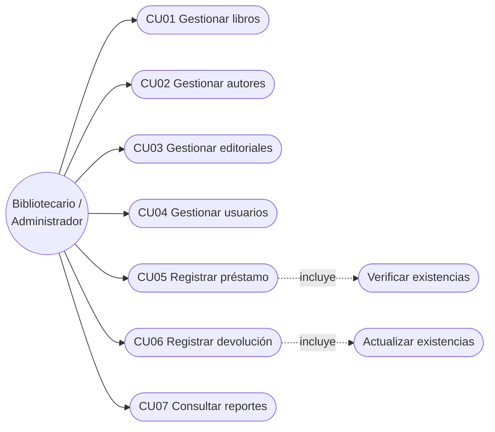

## 5.3 Descripción de casos de uso

### CU01 – Gestionar libros

**Actor principal:** Bibliotecario / Administrador

**Descripción:** permite registrar, consultar, actualizar, eliminar y buscar libros.

**Precondiciones:**
- La aplicación está conectada a la base de datos.
- Existen autores y editoriales registrados (para asociarlos al libro).

**Flujo principal:**
1. El actor ingresa al módulo de libros.
2. El sistema muestra los libros registrados en un `DataGridView`.
3. El actor selecciona la operación (guardar, editar, eliminar o buscar por ISBN; con doble clic sobre una fila carga los datos en el formulario).
4. El actor completa o modifica los datos (ISBN, título, autor, editorial, categoría, año, existencias).
5. El sistema valida los datos y ejecuta la operación.
6. El sistema muestra un mensaje de confirmación y actualiza el listado.

**Flujos alternativos:**
- Campos obligatorios vacíos → el sistema muestra un mensaje y no guarda.
- ISBN duplicado → SQL Server rechaza el registro y el sistema muestra el mensaje de error.
- Libro con préstamos asociados → la clave foránea impide la eliminación y el sistema muestra el error.
- Año o existencias no numéricos → el sistema muestra una advertencia.

**Postcondiciones:** el libro queda registrado, actualizado o eliminado en la base de datos.

---

### CU02 – Gestionar autores

**Actor principal:** Bibliotecario / Administrador
**Descripción:** permite registrar, consultar, actualizar y eliminar autores.
**Precondiciones:** conexión activa con la base de datos.
**Flujo principal:** ingresar al módulo → ver listado → diligenciar Nombre y Apellido → guardar/editar/eliminar → el sistema valida y confirma.
**Flujos alternativos:** campos vacíos; autor con libros asociados (la base de datos impide eliminarlo y se muestra el error).
**Postcondiciones:** el autor queda registrado o actualizado.

### CU03 – Gestionar editoriales

**Actor principal:** Bibliotecario / Administrador
**Descripción:** permite registrar, consultar, actualizar y eliminar editoriales.
**Precondiciones:** conexión activa con la base de datos.
**Flujo principal:** ingresar al módulo → ver listado → diligenciar Nombre → guardar/editar/eliminar → el sistema valida y confirma.
**Flujos alternativos:** nombre vacío; editorial con libros asociados (la base de datos impide eliminarla y se muestra el error).
**Postcondiciones:** la editorial queda registrada o actualizada.

### CU04 – Gestionar usuarios

**Actor principal:** Bibliotecario / Administrador
**Descripción:** permite registrar, consultar, actualizar y eliminar usuarios de la biblioteca.
**Precondiciones:** conexión activa con la base de datos.
**Flujo principal:** ingresar al módulo → ver listado → diligenciar Nombre, Apellido, Documento, Teléfono y Correo → guardar/editar/eliminar → el sistema valida y confirma.
**Flujos alternativos:** campos vacíos; documento duplicado (rechazado por la restricción `UNIQUE`); usuario con préstamos asociados (la base de datos impide eliminarlo).
**Postcondiciones:** el usuario queda registrado o actualizado.

---

### CU05 – Registrar préstamo

**Actor principal:** Bibliotecario / Administrador

**Descripción:** permite registrar el préstamo de un libro a un usuario.

**Precondiciones:**
- El usuario debe existir.
- El libro debe existir.
- El libro debe tener existencias (`Existencias > 0`).

**Flujo principal:**
1. El actor ingresa al módulo de préstamos.
2. Selecciona el usuario (`ComboBox`).
3. Selecciona el libro (`ComboBox`).
4. Indica la fecha del préstamo (`DateTimePicker`).
5. El sistema verifica las existencias.
6. El sistema registra el préstamo con estado «Prestado».
7. El sistema descuenta una existencia del libro.
8. El sistema muestra la confirmación y actualiza el listado.

**Flujos alternativos:**
- Usuario o libro sin seleccionar → advertencia y no se guarda.
- Libro sin existencias → se muestra «No hay existencias disponibles» y no se registra el préstamo.

**Postcondiciones:** el préstamo queda registrado y las existencias del libro actualizadas.

---

### CU06 – Registrar devolución

**Actor principal:** Bibliotecario / Administrador

**Descripción:** permite registrar la devolución de un libro asociado a un préstamo.

**Precondiciones:** debe existir un préstamo con estado «Prestado».

**Flujo principal:**
1. El actor selecciona el préstamo activo en la tabla.
2. Marca e indica la fecha de devolución (`DateTimePicker`).
3. Pulsa el botón «Devolver» y confirma.
4. El sistema actualiza `FechaDevolucion` y cambia el estado a «Devuelto».
5. El sistema incrementa en 1 las existencias del libro.
6. El sistema muestra la confirmación.

**Flujos alternativos:**
- Préstamo ya devuelto → el sistema muestra «Este préstamo ya fue devuelto» y no repite la operación.
- Fecha de devolución sin marcar → advertencia.
- Fecha anterior a la del préstamo → la restricción `CHECK` de la base de datos la rechaza y se muestra el error.

**Postcondiciones:** el préstamo queda en estado «Devuelto» y las existencias actualizadas.

---

### CU07 – Consultar reportes

**Actor principal:** Bibliotecario / Administrador
**Descripción:** permite consultar información consolidada de la biblioteca.
**Flujo principal:** ingresar al módulo de reportes → elegir el tipo de reporte (Préstamos activos, Préstamos devueltos o Inventario de libros) → pulsar «Generar» → el sistema ejecuta la consulta y muestra los resultados en un `DataGridView`.
**Postcondiciones:** la información se muestra en pantalla.

---

# 6. DIAGRAMA DE CLASES

## 6.1 Descripción

La aplicación se organiza en una clase de acceso a datos (`Conexion`) y en **formularios de Windows Forms** (uno por módulo). Cada formulario es una clase que hereda de `Form`, contiene los eventos de la interfaz y ejecuta directamente las consultas parametrizadas con ADO.NET. En esta versión **no se implementaron clases de entidad, DAO ni controladores**; se proponen como mejora en las recomendaciones.

## 6.2 Diagrama de clases

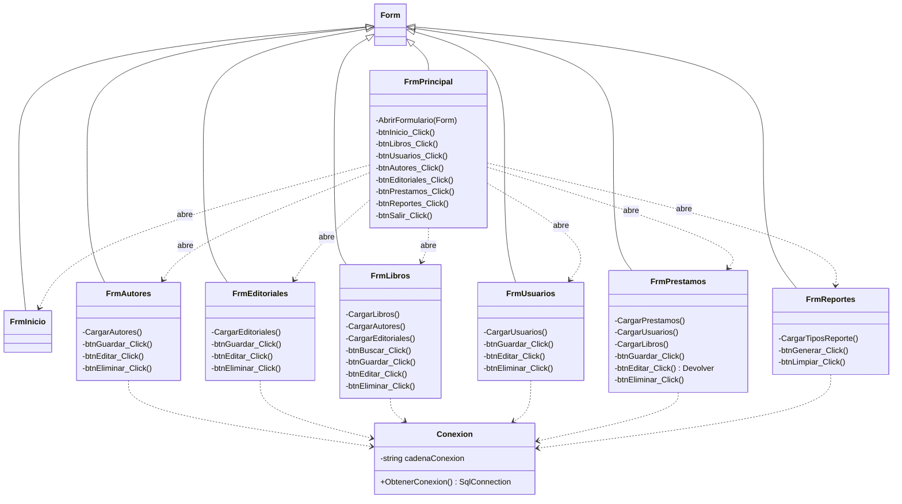

## 6.3 Principales clases

| Clase | Responsabilidad |
|---|---|
| `Conexion` (`Datos/Conexion.cs`) | Crear y entregar la conexión a SQL Server (`SqlConnection`). |
| `FrmPrincipal` | Formulario contenedor: menú lateral y panel donde se incrustan los demás formularios. |
| `FrmInicio` | Pantalla de bienvenida. |
| `FrmAutores` / `FrmEditoriales` / `FrmUsuarios` | CRUD de cada entidad, con validación de campos obligatorios. |
| `FrmLibros` | CRUD de libros, búsqueda por ISBN y carga de autores/editoriales en `ComboBox`. |
| `FrmPrestamos` | Registro de préstamos, devolución y eliminación, con actualización de existencias. |
| `FrmReportes` | Generación de reportes (préstamos activos, devueltos e inventario). |

## 6.4 Aplicación de POO

- **Clases y objetos:** cada pantalla es una clase (`partial class` que hereda de `Form`) y se instancia como objeto al navegar (por ejemplo, `new FrmLibros()`).
- **Herencia:** todos los formularios heredan de `System.Windows.Forms.Form`.
- **Encapsulamiento:** la cadena de conexión es un campo `private` de `Conexion`, que expone solo `ObtenerConexion()`; los métodos auxiliares de los formularios (`CargarLibros`, `AbrirFormulario`, etc.) son `private`.
- **Constructores:** cada formulario inicializa sus componentes y carga sus datos en el constructor o en el evento `Load`.
- **Métodos y eventos:** cada operación (guardar, editar, eliminar, buscar) es un método manejador de eventos.
- **Reutilización:** `Conexion` se reutiliza en todos los módulos para no repetir la cadena de conexión.
- **Mejora propuesta:** crear clases de entidad (`Libro`, `Autor`, etc.) con propiedades y constructores, y clases DAO/controladoras para separar la lógica de los formularios.

---

# 7. MODELO ENTIDAD-RELACIÓN

## 7.1 Descripción y análisis

El modelo se diseñó a partir del análisis de los requisitos del sistema, que debe permitir registrar, consultar, modificar y eliminar libros; administrar autores, editoriales y usuarios; relacionar cada libro con su autor y editorial; gestionar préstamos y devoluciones; controlar el estado del libro; validar datos obligatorios y evitar duplicados; y generar reportes.

### 7.1.1 Determinación de entidades y atributos

| Entidad | Atributos principales |
|---|---|
| Autor | IdAutor, Nombre, Apellido |
| Editorial | IdEditorial, Nombre |
| Libro | ISBN, Título, IdAutor, IdEditorial, Categoría, Año, Existencias |
| Usuario | IdUsuario, Nombre, Apellido, Documento, Teléfono, Correo |
| Préstamo | IdPréstamo, IdUsuario, ISBN, FechaPréstamo, FechaDevolución, Estado |

### 7.1.2 Tabla inicial (sin normalizar)

En una primera aproximación, toda la información podría almacenarse en una única tabla:

**BIBLIOTECA (No normalizada)**

| IdPréstamo | FechaPréstamo | FechaDevolución | Estado | ISBN | Título | NombreAutor | NombreEditorial | NombreUsuario | DocumentoUsuario |
|---|---|---|---|---|---|---|---|---|---|
| 1 | 01/03/2026 | 15/03/2026 | Prestado | 978123 | C# Básico | Juan Pérez | McGraw-Hill | Ana López | 12345678 |

**Problemas de esta tabla:**
- **Redundancia de datos:** autores, editoriales y usuarios se repiten.
- **Anomalías de inserción:** no se puede registrar un autor sin un libro.
- **Anomalías de actualización:** cambiar un dato implica modificar muchas filas.
- **Anomalías de eliminación:** al borrar un libro se pierde información relacionada.

### 7.1.3 Proceso de normalización

| Forma normal | Criterio aplicado | Resultado |
|---|---|---|
| **1FN** | Cada campo contiene un único valor (no hay listas de autores, editoriales o usuarios) y se eliminan los grupos repetidos. | Datos atómicos. |
| **2FN** | Los atributos no clave dependen de la clave primaria completa de su tabla; se separan los datos que corresponden a entidades diferentes. | Se separan Autores, Editoriales, Usuarios, Libros y Préstamos. |
| **3FN** | Se eliminan las dependencias transitivas; cada atributo depende solo de la clave primaria de su tabla. | Los datos de autor/editorial/usuario dependen de su propia tabla y no del libro/préstamo. |

**Resultado:** se obtienen **5 tablas relacionadas** que eliminan redundancias y garantizan la integridad referencial: **Autores, Editoriales, Libros, Usuarios y Préstamos**.

## 7.2 Diagrama entidad-relación

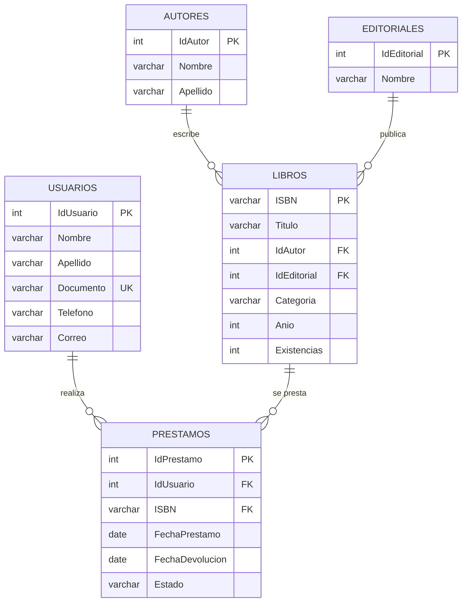

## 7.3 Relaciones y cardinalidad

| Relación | Cardinalidad | Descripción |
|---|---|---|
| Autores → Libros | 1 : N | Un autor puede escribir muchos libros; cada libro tiene un solo autor. |
| Editoriales → Libros | 1 : N | Una editorial puede publicar muchos libros; cada libro tiene una sola editorial. |
| Usuarios → Préstamos | 1 : N | Un usuario puede realizar varios préstamos. |
| Libros → Préstamos | 1 : N | Un libro puede ser prestado muchas veces (según existencias). |

---

# 8. DICCIONARIO DE DATOS

## 8.1 Convenciones

| Abreviatura | Significado |
|---|---|
| PK | Clave primaria |
| FK | Clave foránea |
| UQ | Campo con valor único |
| NULL | Campo que puede estar vacío |
| NOT NULL | Campo obligatorio |

> **Base de datos:** `AcaBiblioteca` (SQL Server 2022, instancia `.\SQL2022`). La columna «Año» se nombra `Anio` en el script SQL para evitar problemas con caracteres especiales.

## 8.2 Tabla: Autores

| Campo | Tipo de dato | Clave | Nulo | Descripción |
|---|---|---|---|---|
| IdAutor | INT IDENTITY(1,1) | PK | No | Identificador único del autor. |
| Nombre | VARCHAR(100) | - | No | Nombre del autor. |
| Apellido | VARCHAR(100) | - | No | Apellido del autor. |

## 8.3 Tabla: Editoriales

| Campo | Tipo de dato | Clave | Nulo | Descripción |
|---|---|---|---|---|
| IdEditorial | INT IDENTITY(1,1) | PK | No | Identificador único de la editorial. |
| Nombre | VARCHAR(150) | - | No | Nombre de la editorial. |

## 8.4 Tabla: Libros

| Campo | Tipo de dato | Clave | Nulo | Descripción |
|---|---|---|---|---|
| ISBN | VARCHAR(20) | PK | No | Código ISBN único del libro. |
| Titulo | VARCHAR(200) | - | No | Título del libro. |
| IdAutor | INT | FK → Autores(IdAutor) | No | Autor del libro. |
| IdEditorial | INT | FK → Editoriales(IdEditorial) | No | Editorial del libro. |
| Categoria | VARCHAR(100) | - | No | Categoría o género del libro. |
| Anio | INT | - | No | Año de publicación. |
| Existencias | INT | - | No | Cantidad de ejemplares disponibles (CHECK ≥ 0). |

## 8.5 Tabla: Usuarios

| Campo | Tipo de dato | Clave | Nulo | Descripción |
|---|---|---|---|---|
| IdUsuario | INT IDENTITY(1,1) | PK | No | Identificador único del usuario. |
| Nombre | VARCHAR(100) | - | No | Nombre del usuario. |
| Apellido | VARCHAR(100) | - | No | Apellido del usuario. |
| Documento | VARCHAR(30) | UQ | No | Número de documento (único). |
| Telefono | VARCHAR(30) | - | Sí | Teléfono de contacto. |
| Correo | VARCHAR(150) | - | No | Correo electrónico. |

## 8.6 Tabla: Prestamos

| Campo | Tipo de dato | Clave | Nulo | Descripción |
|---|---|---|---|---|
| IdPrestamo | INT IDENTITY(1,1) | PK | No | Identificador único del préstamo. |
| IdUsuario | INT | FK → Usuarios(IdUsuario) | No | Usuario que realiza el préstamo. |
| ISBN | VARCHAR(20) | FK → Libros(ISBN) | No | Libro prestado. |
| FechaPrestamo | DATE | - | No | Fecha en que se realizó el préstamo. |
| FechaDevolucion | DATE | - | Sí | Fecha de devolución (NULL mientras no se devuelva). |
| Estado | VARCHAR(20) | - | No | Estado del préstamo (`Prestado` / `Devuelto`; el modelo también contempla `Disponible`). |

## 8.7 Reglas de negocio y restricciones en la base de datos

- Un libro puede tener **un solo autor** (FK `IdAutor`).
- Una editorial puede publicar **muchos libros**.
- Un usuario puede tener **varios préstamos**.
- Un libro puede prestarse muchas veces según **existencias**.
- No se puede prestar un libro si **no hay existencias**.
- El **documento** del usuario debe ser **único** (`UNIQUE`).
- Los campos obligatorios **no pueden ser nulos** (`NOT NULL`).

---

# 9. ARQUITECTURA DEL SISTEMA

## 9.1 Descripción general

La aplicación sigue una organización en capas **lógicas**, con tres niveles físicos en el código:

1. **Presentación y lógica de la aplicación:** formularios de Windows Forms (`Frm*.cs`), que capturan datos, validan campos obligatorios y tipos, y ejecutan las operaciones.
2. **Acceso a datos:** clase `Conexion` (carpeta `Datos/`) y consultas parametrizadas con ADO.NET escritas en cada formulario.
3. **Base de datos:** SQL Server (`AcaBiblioteca`).

> **Nota:** en esta versión la capa de lógica de negocio no está separada en clases propias; las reglas (existencias, estado del préstamo, validaciones) se aplican en los eventos de los formularios y mediante restricciones de la base de datos. Separarla en controladores y DAO se plantea como mejora (sección 15).

## 9.2 Diagrama de arquitectura

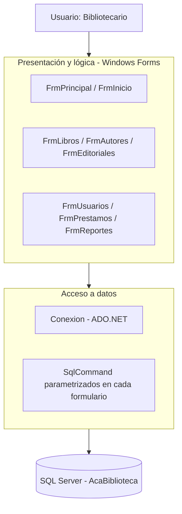

## 9.3 Capa de Presentación

**Responsabilidad:** permite al usuario interactuar con el sistema: captura datos, valida campos obligatorios y numéricos, y presenta resultados y mensajes (`MessageBox`).

**Componentes (formularios):** `FrmPrincipal`, `FrmInicio`, `FrmLibros`, `FrmAutores`, `FrmEditoriales`, `FrmUsuarios`, `FrmPrestamos`, `FrmReportes`.

**Tecnología:** C#, Windows Forms, .NET 10 (`net10.0-windows`), con la librería `FontAwesome.Sharp` para los íconos.

**Controles utilizados:** `Label`, `TextBox`, `ComboBox`, `DataGridView`, `Button`, `Panel`, `DateTimePicker`.

**Navegación:** `FrmPrincipal` tiene un menú lateral y un panel de contenido (`pnlContenido`) donde se incrusta cada formulario como control hijo (`TopLevel = false`).

## 9.4 Reglas de negocio aplicadas

Se aplican en los formularios y en la base de datos:

- Validar que los campos obligatorios no estén vacíos.
- Validar que año y existencias sean números enteros.
- Verificar que existan existencias antes de prestar.
- Descontar una existencia al prestar y sumarla al devolver o al eliminar un préstamo activo.
- Impedir devolver un préstamo que ya está «Devuelto».
- Integridad referencial, unicidad (ISBN, Documento) y rangos (`CHECK`) delegados a SQL Server.

## 9.5 Capa de Acceso a Datos

**Responsabilidad:** gestionar la comunicación con SQL Server.

**Componentes:** clase `Conexion`; `SqlConnection`, `SqlCommand`, `SqlDataAdapter` y `SqlDataReader` de **Microsoft.Data.SqlClient**, con parámetros (`@Nombre`, `@ISBN`, etc.) en todas las consultas de escritura y búsqueda.

## 9.6 Capa de Base de Datos

**Base de datos:** `AcaBiblioteca`
**Tablas:** `Autores`, `Editoriales`, `Libros`, `Usuarios`, `Prestamos`.
Incluye claves primarias y foráneas, restricciones `UNIQUE`, `NOT NULL` y `CHECK`.

## 9.7 Flujo de información

```text
Usuario
   ↓
Formularios (Windows Forms: validación y eventos)
   ↓
Conexion + consultas parametrizadas (ADO.NET)
   ↓
SQL Server
```

Las respuestas de la base de datos realizan el recorrido inverso hasta llegar a la interfaz.

---

# 10. EXPLICACIÓN DE CADA MÓDULO DESARROLLADO

## 10.1 Módulo de inicio (formulario principal)

**Objetivo:** presentar la interfaz principal y facilitar la navegación entre módulos.
**Formularios:** `FrmPrincipal` (menú lateral con botones Inicio, Libros, Usuarios, Autores, Editoriales, Préstamos, Reportes y Salir) y `FrmInicio` (pantalla de bienvenida con el logo).

## 10.2 Módulo de libros (`FrmLibros`)

**Objetivo:** administrar la información bibliográfica y sus relaciones con autores y editoriales.
**Funcionalidades:** guardar, listar, editar, eliminar y buscar por ISBN; doble clic en la tabla para cargar el registro.
**Validaciones:**
- ISBN, título, autor, editorial, categoría, año y existencias obligatorios.
- Año y existencias deben ser enteros.
- Autor y editorial se eligen desde `ComboBox` cargados de la base de datos.
- ISBN único (clave primaria) y existencias ≥ 0 (`CHECK`): los controla SQL Server y el error se muestra al usuario.
- Un libro con préstamos asociados no puede eliminarse (clave foránea).

## 10.3 Módulo de autores (`FrmAutores`)

**Objetivo:** administrar los autores de la biblioteca.
**Funcionalidades:** guardar, listar, editar y eliminar (con confirmación).
**Validaciones:** nombre y apellido obligatorios; un autor con libros asociados no puede eliminarse.

## 10.4 Módulo de editoriales (`FrmEditoriales`)

**Objetivo:** administrar las editoriales.
**Funcionalidades:** guardar, listar, editar y eliminar (con confirmación).
**Validaciones:** nombre obligatorio; una editorial con libros asociados no puede eliminarse.

## 10.5 Módulo de usuarios (`FrmUsuarios`)

**Objetivo:** administrar los usuarios de la biblioteca.
**Funcionalidades:** guardar, listar, editar y eliminar (con confirmación).
**Validaciones:** nombre, apellido, documento, teléfono y correo obligatorios en el formulario; documento único (`UNIQUE` en la base de datos); un usuario con préstamos no puede eliminarse.

## 10.6 Módulo de préstamos y devoluciones (`FrmPrestamos`)

**Objetivo:** registrar y controlar los préstamos de libros y sus devoluciones.
**Funcionalidades:**
- **Guardar:** registra el préstamo con estado «Prestado» y resta una existencia al libro.
- **Devolver:** registra la fecha de devolución, cambia el estado a «Devuelto» y suma una existencia.
- **Eliminar:** borra el préstamo; si estaba «Prestado», restituye la existencia.
- Doble clic en la tabla para cargar el préstamo en el formulario.

**Validaciones:** usuario y libro seleccionados; libro con existencias; el préstamo no puede devolverse dos veces; la fecha de devolución debe estar marcada; la fecha de devolución no puede ser anterior al préstamo (`CHECK` de la base de datos).

## 10.7 Módulo de reportes (`FrmReportes`)

**Objetivo:** consultar información consolidada de la biblioteca.
**Reportes implementados:**
- **Préstamos activos:** préstamos en estado «Prestado», con usuario y libro.
- **Préstamos devueltos:** con fecha de devolución.
- **Inventario de libros:** libros con autor, editorial, categoría, año y existencias.

**Ejemplo de consulta (préstamos activos):**

```sql
SELECT p.IdPrestamo,
       u.Nombre + ' ' + u.Apellido AS Usuario,
       l.ISBN, l.Titulo, p.FechaPrestamo, p.Estado
FROM Prestamos p
INNER JOIN Usuarios u ON p.IdUsuario = u.IdUsuario
INNER JOIN Libros   l ON p.ISBN      = l.ISBN
WHERE p.Estado = 'Prestado'
ORDER BY p.FechaPrestamo DESC;
```

---

# 11. DESCRIPCIÓN DE LA CONEXIÓN CON SQL SERVER

La conexión se gestiona con **ADO.NET** (paquete `Microsoft.Data.SqlClient`), centralizada en la clase `Conexion` (`Datos/Conexion.cs`) para no repetir la cadena de conexión. Usa autenticación integrada de Windows (sin usuario ni contraseña en el código).

**Clase de conexión (código real del proyecto):**

```csharp
using Microsoft.Data.SqlClient;

namespace AcaBiblioteca.Datos
{
    public class Conexion
    {
        private string cadenaConexion = "Server=.\\SQL2022;Database=AcaBiblioteca;Integrated Security=true;TrustServerCertificate=true;";

        public SqlConnection ObtenerConexion()
        {
            return new SqlConnection(cadenaConexion);
        }
    }
}
```

**Patrón de uso en los formularios (consulta parametrizada con manejo de excepciones), tomado de `FrmAutores`:**

```csharp
try
{
    Conexion conexion = new Conexion();
    using (SqlConnection cn = conexion.ObtenerConexion())
    {
        cn.Open();
        string consulta = @"INSERT INTO Autores (Nombre, Apellido)
                            VALUES (@Nombre, @Apellido)";
        using (SqlCommand comando = new SqlCommand(consulta, cn))
        {
            comando.Parameters.AddWithValue("@Nombre", txtNombre.Text.Trim());
            comando.Parameters.AddWithValue("@Apellido", txtApellido.Text.Trim());
            comando.ExecuteNonQuery();
        }
    }
    MessageBox.Show("Autor guardado correctamente.", "Biblioteca",
        MessageBoxButtons.OK, MessageBoxIcon.Information);
}
catch (Exception ex)
{
    MessageBox.Show("Error al guardar el autor:\n" + ex.Message, "Biblioteca",
        MessageBoxButtons.OK, MessageBoxIcon.Error);
}
```

**Registro de un préstamo (`FrmPrestamos`):** primero se consulta `Existencias` del libro; si es mayor que cero se inserta el préstamo con estado `'Prestado'` y luego se ejecuta `UPDATE Libros SET Existencias = Existencias - 1`. La devolución hace el proceso inverso (`UPDATE Prestamos ... Estado = 'Devuelto'` y `Existencias + 1`).

> **Limitación conocida:** estas operaciones usan comandos consecutivos sin `SqlTransaction`. Si fallara el segundo comando, los datos quedarían inconsistentes. Se recomienda envolverlas en una transacción (sección 15).

---

# 12. CAPTURAS DE PANTALLA DEL SISTEMA

> Imágenes ubicadas en la carpeta `capturas/` del repositorio (ejecutar la aplicación y capturar cada pantalla).

## 12.1 Menú principal


## 12.2 Gestión de libros
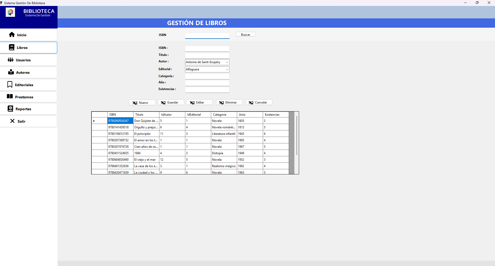
**Descripción:** registro, edición, eliminación y búsqueda de libros, con listado en `DataGridView`.

## 12.3 Gestión de autores
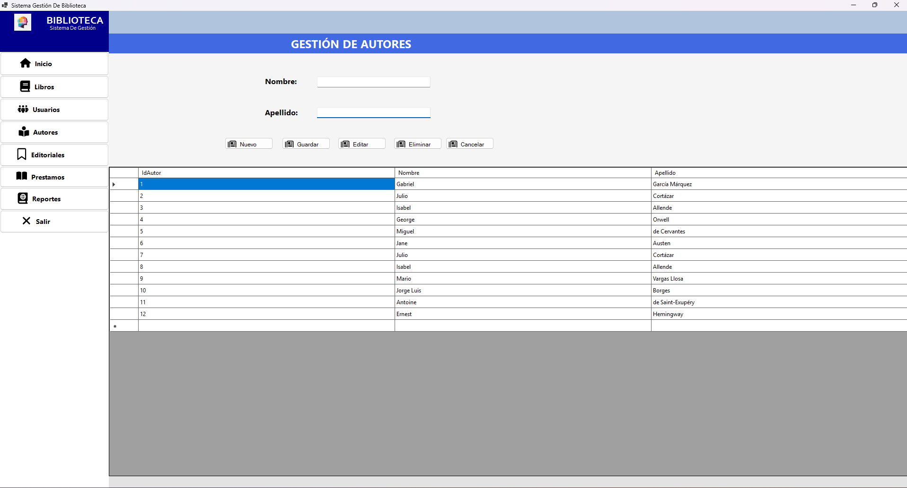
**Descripción:** CRUD de autores.

## 12.4 Gestión de editoriales
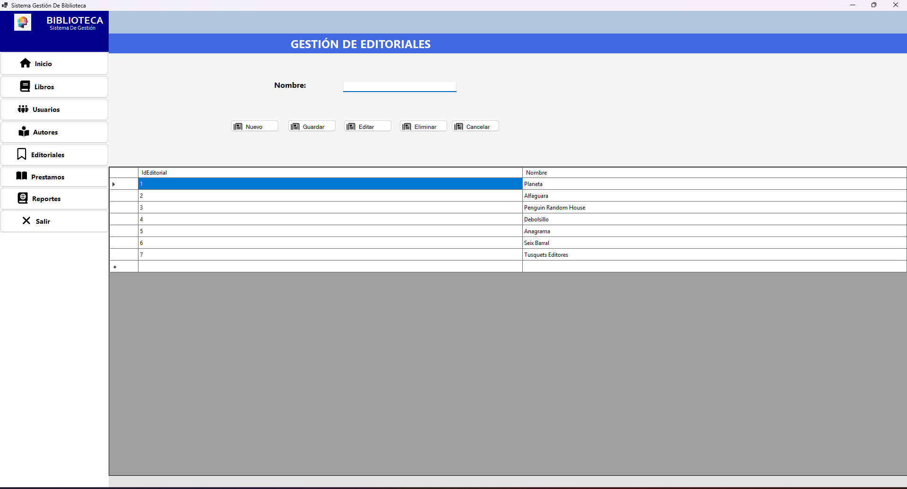
**Descripción:** CRUD de editoriales.

## 12.5 Gestión de usuarios
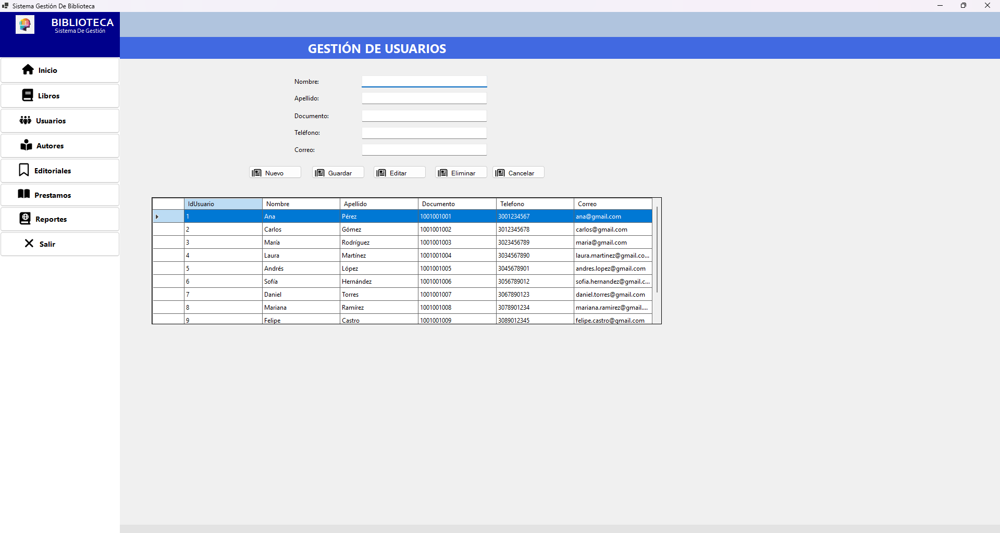
**Descripción:** CRUD de usuarios con validación de documento único.

## 12.6 Préstamos y devoluciones
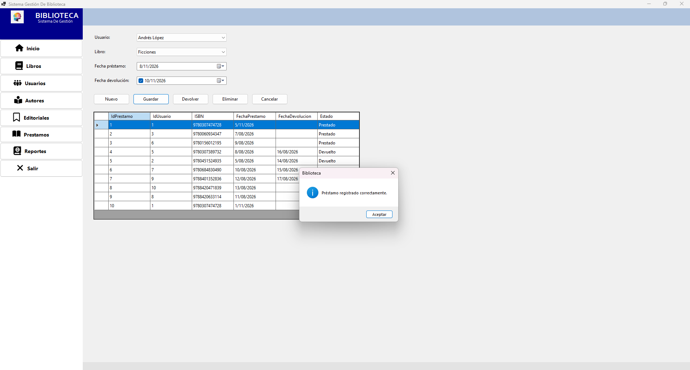
**Descripción:** selección de usuario y libro, fecha de préstamo y fecha de devolución; botones Guardar, Devolver y Eliminar.

## 12.7 Devolución registrada
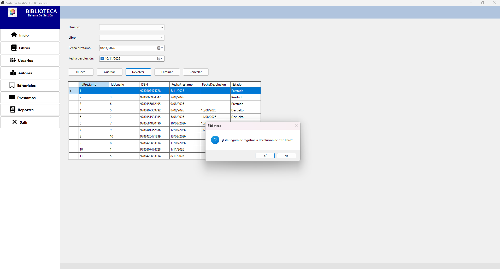
**Descripción:** préstamo con estado «Devuelto» tras pulsar «Devolver».

## 12.8 Reportes
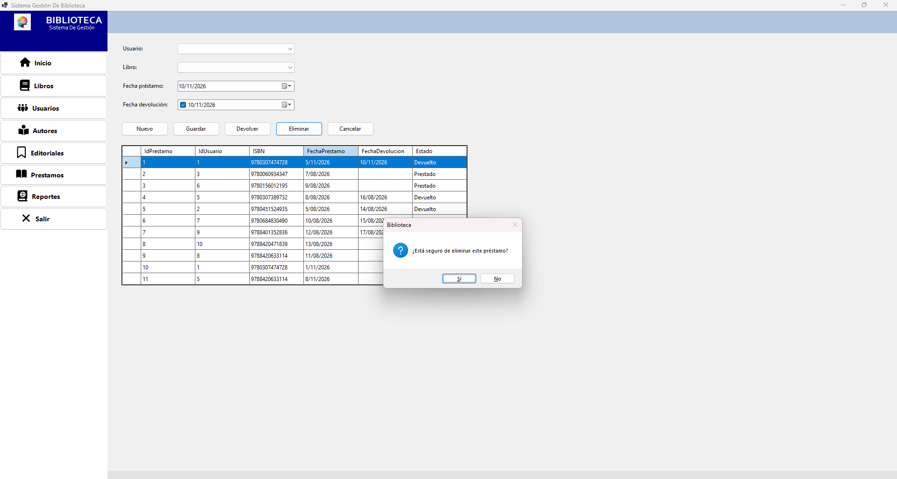
**Descripción:** selección del tipo de reporte (préstamos activos, devueltos o inventario) y resultados en el `DataGridView`.

---

# 13. PRUEBAS DE FUNCIONAMIENTO

## 13.1 Estrategia de pruebas

Se realizan **pruebas funcionales manuales** sobre cada módulo, ejecutando la aplicación con los datos de prueba del script SQL. Para cada caso se verificó el resultado en pantalla y, cuando fue necesario, directamente en SQL Server (consultando las tablas). Se probaron casos válidos y casos de error (campos vacíos, duplicados, sin existencias, restricciones de integridad).

## 13.2 Casos de prueba

> **Complete las columnas «Resultado obtenido» y «Estado» después de ejecutar cada prueba en su aplicación.** Solo marque *Aprobado* lo que realmente funcionó.

| ID | Funcionalidad | Entrada / Acción | Resultado esperado | Resultado obtenido | Estado |
|---|---|---|---|---|---|
| CP01 | Registrar libro | Datos válidos | Libro registrado y visible en el listado | [Completar] | [ ] |
| CP02 | Registrar libro | ISBN repetido | Mensaje de error de la base de datos (clave duplicada); no se guarda | [Completar] | [ ] |
| CP03 | Registrar libro | Campo obligatorio vacío o año no numérico | «Complete todos los campos…» / «El año debe ser un número entero» | [Completar] | [ ] |
| CP04 | Registrar autor / editorial | Datos válidos | Registro creado | [Completar] | [ ] |
| CP05 | Eliminar autor | Autor con libros asociados | Error de clave foránea; no se elimina | [Completar] | [ ] |
| CP06 | Registrar usuario | Datos válidos | Usuario registrado | [Completar] | [ ] |
| CP07 | Registrar usuario | Documento duplicado | Error de la restricción `UNIQUE`; no se guarda | [Completar] | [ ] |
| CP08 | Registrar usuario | Algún campo vacío | «Complete todos los campos antes de guardar» | [Completar] | [ ] |
| CP09 | Registrar préstamo | Usuario y libro con existencias | Préstamo «Prestado»; existencias −1 | [Completar] | [ ] |
| CP10 | Registrar préstamo | Libro con `Existencias = 0` | «No hay existencias disponibles de este libro» | [Completar] | [ ] |
| CP11 | Registrar devolución | Préstamo activo | Estado «Devuelto», fecha registrada, existencias +1 | [Completar] | [ ] |
| CP12 | Registrar devolución | Préstamo ya devuelto | «Este préstamo ya fue devuelto»; no se repite | [Completar] | [ ] |
| CP13 | Editar libro | Cambiar categoría/año | Datos actualizados | [Completar] | [ ] |
| CP14 | Buscar libro | ISBN existente | Los datos del libro se cargan en el formulario | [Completar] | [ ] |
| CP15 | Reporte préstamos activos | Elegir el reporte y pulsar «Generar» | Se muestran solo préstamos «Prestado» |
| CP16 | Eliminar préstamo activo | Eliminar préstamo «Prestado» | Préstamo eliminado y existencias +1 |
| CP17 | Navegación | Botón «Reportes» del menú | Se abre el módulo de reportes | [Completar] | [ ] |

## 13.3 Evidencias de pruebas

### Prueba CP02 – ISBN duplicado
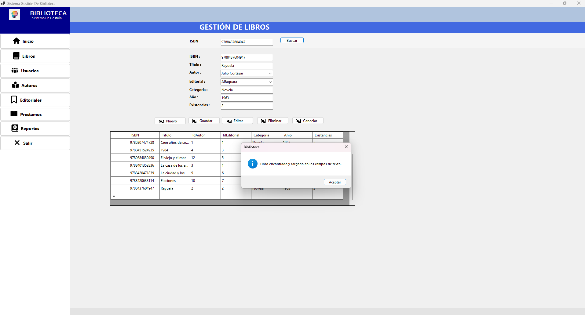
**Resultado:** 

### Prueba CP09 – Registro de préstamo

**Resultado:** 

### Prueba CP11 – Devolución

**Resultado:** 

---

# 14. CONCLUSIONES

1. **Logro del proyecto:** se desarrolló una aplicación de escritorio en C# (.NET 10) con Windows Forms y SQL Server que permite administrar libros, autores, editoriales y usuarios, y gestionar préstamos, devoluciones y reportes, cumpliendo con el alcance definido.

2. **POO:** el proyecto aplica clases, objetos, herencia (los formularios heredan de `Form`), encapsulamiento (`Conexion` con cadena privada) y reutilización de código. Como mejora se plantea incorporar clases de entidad y de acceso a datos para reducir la lógica dentro de los formularios.

3. **Base de datos y arquitectura:** la normalización hasta 3FN eliminó la redundancia y las anomalías de inserción, actualización y eliminación, dando origen a cinco tablas relacionadas con integridad referencial. La centralización de la conexión en la clase `Conexion` y la separación en un formulario por módulo facilitaron el mantenimiento y la comprensión del sistema.

4. **Validaciones y excepciones:** las validaciones de campos obligatorios y de tipos numéricos, las consultas parametrizadas y el manejo de excepciones con `try/catch` aumentaron la confiabilidad de la aplicación; las restricciones de la base de datos (`UNIQUE`, `CHECK`, claves foráneas) complementan estas validaciones.

5. **Dificultades y soluciones:** [Describa con sus palabras las dificultades reales que tuvo —por ejemplo, la conexión a la instancia `.\SQL2022`, el manejo de claves foráneas al eliminar o la actualización de existencias en préstamos y devoluciones— y cómo las resolvió.]

---

# 15. RECOMENDACIONES

- **Arquitectura:** crear clases de entidad (`Libro`, `Autor`, `Editorial`, `Usuario`, `Prestamo`), clases DAO y controladores para sacar la lógica de los formularios.
- **Consistencia:** usar `SqlTransaction` en el registro de préstamos, devoluciones y eliminación de préstamos para que el cambio de estado y de existencias sea atómico.
- **Validaciones:** validar el formato del correo y la fecha de devolución en la aplicación, verificar duplicados antes de insertar y mostrar mensajes más claros que el error de la base de datos; permitir teléfono opcional, como en la base de datos.
- **Búsqueda:** ampliar la búsqueda de libros por título o autor.
- **Futuras mejoras:** incorporar autenticación con roles (administrador/bibliotecario), cálculo de multas por retraso, reservas de libros y soporte para varios autores por libro (tabla intermedia `LibroAutor`).
- **Seguridad:** el proyecto usa autenticación de Windows (no guarda contraseñas); se recomienda mover la cadena de conexión a un archivo de configuración y mantener las consultas parametrizadas.
- **Mantenimiento:** realizar copias de seguridad periódicas de la base de datos y mantener el repositorio con commits frecuentes y descriptivos.
- **Nuevas funcionalidades:** exportar reportes a PDF/Excel, agregar gráficos y alertas de préstamos vencidos.
- **Calidad:** agregar pruebas unitarias a la capa de lógica de negocio.

---

# 16. REFERENCIAS BIBLIOGRÁFICAS

> Normas APA 7.ª edición. 


Microsoft. (s. f.). *Windows Forms documentation*. Microsoft Learn. https://learn.microsoft.com/en-us/dotnet/desktop/winforms/

Microsoft. (s. f.). *SQL Server documentation*. Microsoft Learn. https://learn.microsoft.com/en-us/sql/sql-server/

Microsoft. (s. f.). *ADO.NET overview*. Microsoft Learn. https://learn.microsoft.com/en-us/dotnet/framework/data/adonet/ado-net-overview

Microsoft. (s. f.). *C# documentation*. Microsoft Learn. https://learn.microsoft.com/en-us/dotnet/csharp/


---

# ANEXOS

## Anexo A. Repositorio GitHub

**Repositorio:** https://github.com/lauragonzalezcassti-art/AcaBiblioteca

Estructura sugerida:

Estructura actual del repositorio:

```text
/AcaBiblioteca
 ├── AcaBiblioteca/                (solución de Visual Studio, .slnx)
 │    └── AcaBiblioteca/           (proyecto WinForms net10.0-windows)
 │         ├── Datos/Conexion.cs
 │         ├── FrmPrincipal, FrmInicio, FrmLibros, FrmAutores,
 │         │   FrmEditoriales, FrmUsuarios, FrmPrestamos, FrmReportes
 │         ├── Program.cs
 │         └── Resources/
 ├── Documentacion.md
 ├── .gitignore
 └── .gitattributes
```


## Anexo B. Script de base de datos

**Archivo:** `database/AcaBiblioteca.sql` 

```sql
-- =====================================================
-- Sistema de Gestión de Biblioteca - SQL Server
-- =====================================================
CREATE DATABASE AcaBiblioteca;
GO
USE AcaBiblioteca;
GO

-- ---------- TABLAS ----------
CREATE TABLE Autores (
    IdAutor     INT IDENTITY(1,1) PRIMARY KEY,
    Nombre      VARCHAR(100) NOT NULL,
    Apellido    VARCHAR(100) NOT NULL
);

CREATE TABLE Editoriales (
    IdEditorial INT IDENTITY(1,1) PRIMARY KEY,
    Nombre      VARCHAR(150) NOT NULL
);

CREATE TABLE Libros (
    ISBN        VARCHAR(20)  PRIMARY KEY,
    Titulo      VARCHAR(200) NOT NULL,
    IdAutor     INT          NOT NULL,
    IdEditorial INT          NOT NULL,
    Categoria   VARCHAR(100) NOT NULL,
    Anio        INT          NOT NULL,
    Existencias INT          NOT NULL,
    CONSTRAINT FK_Libros_Autores     FOREIGN KEY (IdAutor)     REFERENCES Autores(IdAutor),
    CONSTRAINT FK_Libros_Editoriales FOREIGN KEY (IdEditorial) REFERENCES Editoriales(IdEditorial),
    CONSTRAINT CK_Libros_Existencias CHECK (Existencias >= 0),
    CONSTRAINT CK_Libros_Anio        CHECK (Anio > 0)
);

CREATE TABLE Usuarios (
    IdUsuario   INT IDENTITY(1,1) PRIMARY KEY,
    Nombre      VARCHAR(100) NOT NULL,
    Apellido    VARCHAR(100) NOT NULL,
    Documento   VARCHAR(30)  NOT NULL,
    Telefono    VARCHAR(30)  NULL,
    Correo      VARCHAR(150) NOT NULL,
    CONSTRAINT UQ_Usuarios_Documento UNIQUE (Documento)
);

CREATE TABLE Prestamos (
    IdPrestamo      INT IDENTITY(1,1) PRIMARY KEY,
    IdUsuario       INT         NOT NULL,
    ISBN            VARCHAR(20) NOT NULL,
    FechaPrestamo   DATE        NOT NULL,
    FechaDevolucion DATE        NULL,
    Estado          VARCHAR(20) NOT NULL,
    CONSTRAINT FK_Prestamos_Usuarios FOREIGN KEY (IdUsuario) REFERENCES Usuarios(IdUsuario),
    CONSTRAINT FK_Prestamos_Libros   FOREIGN KEY (ISBN)      REFERENCES Libros(ISBN),
    CONSTRAINT CK_Prestamos_Estado   CHECK (Estado IN ('Disponible','Prestado','Devuelto')),
    CONSTRAINT CK_Prestamos_Fechas   CHECK (FechaDevolucion IS NULL OR FechaDevolucion >= FechaPrestamo)
);
GO

-- ---------- DATOS DE PRUEBA ----------
INSERT INTO Autores (Nombre, Apellido) VALUES
('Juan','Pérez'), ('Gabriel','García Márquez'), ('Isabel','Allende'), ('Robert','Martin');

INSERT INTO Editoriales (Nombre) VALUES
('McGraw-Hill'), ('Sudamericana'), ('Prentice Hall');

INSERT INTO Libros (ISBN, Titulo, IdAutor, IdEditorial, Categoria, Anio, Existencias) VALUES
('978123',        'C# Básico',                  1, 1, 'Programación', 2020, 5),
('9780307474728', 'Cien años de soledad',       2, 2, 'Novela',       1967, 3),
('9788401337208', 'La casa de los espíritus',   3, 2, 'Novela',       1982, 2),
('9780132350884', 'Clean Code',                 4, 3, 'Programación', 2008, 4);

INSERT INTO Usuarios (Nombre, Apellido, Documento, Telefono, Correo) VALUES
('Ana',   'López',   '12345678', '3001234567', 'ana.lopez@correo.com'),
('Carlos','Ramírez', '87654321', '3109876543', 'carlos.ramirez@correo.com'),
('María', 'Gómez',   '11223344', NULL,         'maria.gomez@correo.com');

-- Préstamo activo (descuenta existencia) y uno ya devuelto
INSERT INTO Prestamos (IdUsuario, ISBN, FechaPrestamo, FechaDevolucion, Estado) VALUES
(1, '978123',        '2026-03-01', NULL,         'Prestado'),
(2, '9780307474728', '2026-02-10', '2026-02-24', 'Devuelto');

UPDATE Libros SET Existencias = Existencias - 1 WHERE ISBN = '978123';
GO
```Pendiente de agregar al repositorio: carpeta `database/` con el script SQL (Anexo B), carpeta `capturas/` y `README.md`.
